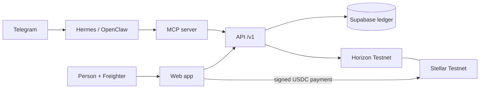

# Stellar-Split

Split shared expenses and settle them in USDC on Stellar, built for families and workers who send money across borders, with agent support via x402.

Built at HackMeridian (Lisbon, 25 to 26 October 2026). Track: Genesis, with Stellar Composed.

> **Status: hackathon build, Stellar Testnet only.** The web app, the group contract, the MCP server for agents and the API run today; see [What works today](#what-works-today). No real money is involved and nothing here is financial advice.

**Live:** https://stellar-split-sooty.vercel.app (API health: [`/v1/health`](https://stellar-split-sooty.vercel.app/v1/health))

## Summary

Shared-expense apps record who owes whom, but the money still moves outside the app. Stellar-Split keeps the ledger and the settlement together: a group records expenses, sees who owes whom, and settles in USDC on Stellar. Money goes directly from the person who owes to the person owed. The app never holds user funds.

## Problem

Many people support family across borders or are paid in a way that makes cashing out difficult. Sending money is often costly and slow, and splitting a shared cost, such as rent paid with money sent from family, happens by hand.

Context from public sources (to be checked before the pitch; see `docs/BUILD-FOCUS.md`):

- Remittances to Mexico reached a record $64.7bn in 2024 and fell about 5% in 2025, the biggest drop since 2009 ([FXC Intelligence](https://www.fxcintel.com/research/analysis/us-mexico-remittances-2025)).
- A 1% US tax on remittances funded by cash, money orders or cashier's cheques started on 1 January 2026. Transfers funded from a bank account or card are exempt ([BBVA Research](https://www.bbvaresearch.com/en/publicaciones/mexico-2026-begins-with-new-remittance-tax/)).
- Stablecoin remittance flows on Stellar already exist, for example Felix Pago with Bitso using USDC ([Stellar case study](https://stellar.org/felix-bitso)).

## What works today

| Part | Where | Status |
|---|---|---|
| Web app: Freighter sign-in, groups, equal and exact splits, balances, settle in Testnet USDC with the tx on Stellar Expert | [`apps/web`](apps/web/README.md) | Merged. Runs on mock data until it is switched to the API ([#55](https://github.com/Michella-stack/Stellar-Split/pull/55)) |
| API: sign-in with a signed message, groups, members, expenses, balances, settlements recorded only after Horizon confirms the payment | [`apps/api`](apps/api/README.md) | In review ([#51](https://github.com/Michella-stack/Stellar-Split/pull/51)), deployed at the live URL above |
| Shared money, split and balance rules used by both | [`packages/shared`](packages/shared/README.md) | Merged |
| Non-custodial Soroban group contract | [`contracts/group`](contracts/README.md) | Deployed on Testnet (below) |
| MCP server for agents: groups, balances, expenses, settlement proposals. It cannot move money | [`mcp`](docs/AGENT-INTERFACE.md) | Merged, not yet connected to the agents |
| Hermes Agent and OpenClaw on Telegram | [`docs/AGENTS.md`](docs/AGENTS.md) | Running for the team; payments are the stretch goal |

Testnet evidence: two USDC payments sent by the web app, [7e15141b…](https://stellar.expert/explorer/testnet/tx/7e15141b4fa3484aa319efcc783a81df6e35ab5d77dfb0576d8c38e80af576de) (1.50 USDC) and [fee0d278…](https://stellar.expert/explorer/testnet/tx/fee0d278e996b207c1998a60959bf85d2bf7dd0621b0b0e6376d9dd2d24d4099) (1.00 USDC).

The plan, what is deferred and the submission checklist are in [`docs/BUILD-FOCUS.md`](docs/BUILD-FOCUS.md). The design is in [`docs/ARCHITECTURE.md`](docs/ARCHITECTURE.md).

## Architecture



- Freighter signs everything a person sends, so the app never sees a secret key. The payment goes straight from the debtor to the creditor.
- The API records a settlement only after Horizon shows a successful USDC payment with the right payer, payee and amount.
- The off-chain ledger is Supabase (PostgreSQL). The Soroban group contract is deployed; settling through its `settle` function comes after the plain transfer.
- Agents reach the ledger only through the MCP server. Agent payments through x402 are the stretch goal.
- Stack: JavaScript (ES modules, JSDoc), Vite + React + Tailwind CSS, Node.js with no runtime dependencies in the API, Supabase.

### Deployed on Stellar Testnet

| Item | Value |
|---|---|
| Group contract | [`CAZDOCJJR3NU5O2N44KQSWUG7C4OBLC6PIQLBFVPXODAYHHITFU7FR3Y`](https://stellar.expert/explorer/testnet/contract/CAZDOCJJR3NU5O2N44KQSWUG7C4OBLC6PIQLBFVPXODAYHHITFU7FR3Y) |
| Deploy transaction | [`56a42289…095fbe6a`](https://stellar.expert/explorer/testnet/tx/56a42289418586c90efec1a09ce36e70a152988067e2c7268fc9b2ec095fbe6a) (25 October 2026) |
| WASM hash | `ca6ba904c5759a963a3b08611a8d4519aa6a8e75670dacab873ace8fe27463e4` |
| Admin and recorder | `GCOURV2JXCIXK3CHXMJ4HBOPS5TMWGLL4AVKTO6A44DYYDJE2FA5I4N4` |

Group 1 on this contract is a smoke test that uses native XLM, not USDC. The Testnet USDC asset and the settlement transaction used in the demo will be listed here.

## Setup

Node.js 24 for the web app, 22 or later for the API and the MCP server.

```sh
cd apps/web && npm ci --ignore-scripts && cp .env.example .env && npm run dev   # http://localhost:5173
cd apps/api && cp .env.example .env && node --env-file=.env src/main.js         # http://localhost:8080
cd mcp && npm ci --ignore-scripts && npm test
cd contracts && cargo test
```

Each part documents its own variables: [`apps/web`](apps/web/README.md#environment-variables), [`apps/api`](apps/api/README.md) (`apps/api/.env.example`) and [`mcp`](docs/AGENT-INTERFACE.md#run). Copy `.env.example` to `.env` and never commit `.env`. `VITE_` variables end up in the browser bundle, so they never hold a secret.

## Demo

The web app and the API run as one Vercel project. How it is built and deployed is in [`docs/DEPLOYMENT.md`](docs/DEPLOYMENT.md).

The three-minute demo script is in [`apps/web/README.md`](apps/web/README.md#demo-script-about-3-minutes). It needs two funded Testnet accounts with a USDC trustline in Freighter.

## Security

Enforced in code and CI today:

- **Testnet only.** The web app refuses another network, and the API refuses to start or verify against anything but Testnet.
- **No secret keys.** Freighter signs. The API and the MCP server refuse any input shaped like a Stellar secret seed before it is stored or logged.
- **Money as integers.** Amounts are decimal strings checked with BigInt stroops: positive, at most seven decimals, splits that add up.
- **Payments are verified.** A settlement is recorded once per transaction hash, after Horizon confirms it, and never for more than is owed.
- **Supply chain.** Every GitHub Action is pinned by commit SHA; Dependabot waits out a cooldown; dependency review, OSV-Scanner, CodeQL and a version guard against outdated or vulnerable versions run on every PR.
- **Agents** run in pinned containers, answer only the team on Telegram, and hold no keys. See [`docs/AGENTS.md`](docs/AGENTS.md).

Threat model and policies: [`docs/security`](docs/security/README.md).

## Docs

- [Product requirements](docs/PRD.md) (written under the working name Ledgerly)
- [Judging criteria](docs/JUDGING.md)
- [Build focus](docs/BUILD-FOCUS.md)
- [Architecture](docs/ARCHITECTURE.md)
- [Agents: setup and access](docs/AGENTS.md)
- [Agent interface (MCP)](docs/AGENT-INTERFACE.md) and [agent wallets](docs/AGENT-WALLETS.md)
- [Security: threat model and policies](docs/security/README.md)
- [Testing status](docs/TESTING.md)
- [Deployment on Vercel](docs/DEPLOYMENT.md)
- [Group contract](contracts/README.md)
- [Security policy](SECURITY.md)
- [Supply chain checks](supply-chain/README.md)

## Release signing key

Planned after the hackathon: release tags and artifacts will be signed with the owner's GPG key, and the key fingerprint will be published here and in `SECURITY.md`.

## Team

Michella Warren, Victor Estival, Damaris Castro, Viviana Andrango, Sofiia Varich.

## Licence

MIT. See [`LICENSE`](LICENSE).
