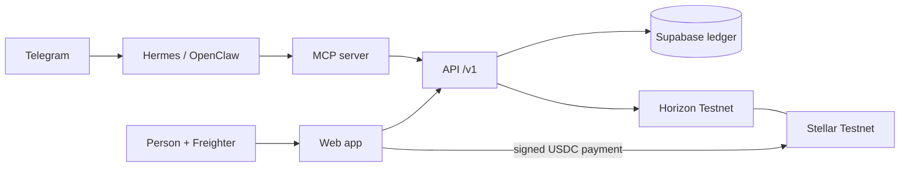

<p align="center">
  <picture>
    <source media="(prefers-color-scheme: dark)" srcset="apps/web/public/logo-horizontal-dark.svg" />
    
  </picture>
</p>

# Stellar-Split

Split shared expenses and settle them in USDC (or EURC, for euro groups) on Stellar, built for families and workers who send money across borders, with agent support via x402.

Built at HackMeridian (Lisbon, 25 to 26 October 2026). Track: Genesis, with Stellar Composed.

> **Status: hackathon build, Stellar Testnet only.** The web app, the group contract, the MCP server for agents and the API run today; see [What works today](#what-works-today). No real money is involved and nothing here is financial advice.

**Live:** https://stellar-split-sooty.vercel.app (API health: [`/v1/health`](https://stellar-split-sooty.vercel.app/v1/health))

## For the judges

| What | Link |
|---|---|
| The app (live, Testnet, built for your phone) | https://stellar-split-sooty.vercel.app |
| Product website | https://stellar-split-site.vercel.app |
| Developer docs: API, integrations, agents and MCP | https://stellar-split-docs.vercel.app |
| Pitch and demo video | https://youtu.be/65e6AzryBUE |
| API health | https://stellar-split-sooty.vercel.app/v1/health |
| Agent payments (to and from the agent) and EURC, with transactions | [Agent payments and EURC on Testnet](#agent-payments-and-eurc-on-testnet) |
| Business model and planned pricing | [Business model](#business-model) |
| How we map to the judging criteria | [docs/JUDGING.md](docs/JUDGING.md) |

> **Note for the judges: what is built and what is planned.** Everything under [What works today](#what-works-today) runs and was checked on Stellar Testnet, and the transactions are listed below. The [Roadmap](#roadmap) at the end of this README is **not built**: it records what we chose to leave out during the event and why, for example sign-in with email or social accounts, more wallets than Freighter, fiat ramps and on-chain limits for agents. Where the app shows something planned, such as the "More wallets" list on the connect screen, it is labelled "Coming soon" and does nothing. What we could not verify is listed in [docs/TESTING.md](docs/TESTING.md) and, for agents, in [docs/AGENT-MCP-ROLLOUT.md](docs/AGENT-MCP-ROLLOUT.md#status-of-the-rollout-26-october-2026).

No wallet? Open the app and choose the demo: the whole app runs on sample data, without Freighter and without touching Stellar. With Freighter on Testnet you can settle real Testnet USDC and see the transaction on Stellar Expert.

The app, the website and the docs are three separate Vercel deployments. The website and the docs live in [`sites/landing`](sites/landing) and [`sites/docs`](sites/docs) as static files and do not change the app.

## Business model

**Splitting and settling stay free, with no cut on payments between people. We earn from the agent that works for you, from groups run by businesses, and from other agents that use our API.** Prices are planned for mainnet. During Testnet everything is free.

| Plan | Planned price | Who pays and for what |
|---|---|---|
| **Free** | €0 | Everyone: unlimited groups and expenses, settlement in USDC or EURC, no fee from us, no ads, 20 Stellar Assist actions a month |
| **Assist Pro** | €3.99 a month or €29 a year | People who want Stellar Assist to pay recurring bills, scan receipts and settle within their limits |
| **Developers** | 1,000 calls a month free, then $0.002 per read and $0.01 per write, paid per call over x402 | Third-party apps and agents using our API and MCP server |
| **Operators** | €2 per active group a month, €49 minimum | Coliving operators, group travel agencies, teams across countries |

Why it works:

- **Free beats the market leader.** Splitwise's free plan stops at roughly 3 to 5 expenses a day and Splitwise Pro costs about $4.99 a month. Assist Pro costs less and does more: an agent that pays.
- **Assist Pro needs no partner,** so it is the first revenue we control. Operators is recurring revenue tied to real rent flows, such as a flat in Spain paid from Mexico.
- **Ramps are upside, not a fee on you.** Cash in and cash out go through licensed Stellar anchors (Bitso and MoneyGram for Mexico, Mykobo for EURC in Europe). Any revenue there comes from a partner agreement with the anchor, never added to your payment.
- **We will not** take a percentage of payments, show ads, or earn yield on balances. We never hold user funds.

How we got there: we started with the idea of charging on the fiat ramps. Three research passes, each citing a source for every number, showed that no Stellar anchor publishes a wallet revenue share, SEP-24 has no field for a wallet fee, and MoneyGram's ramps charge users $0. Adding our own fee to money movement would also make us look like a payment intermediary. So ramps became upside, and the paid product became what nobody else offers: an agent that pays for you, priced under Splitwise Pro.

Research, sources, regulatory notes and what we have not verified yet: [docs/BUSINESS-MODEL.md](docs/BUSINESS-MODEL.md).

## Challenges we ran into

- **Making settlement trustworthy without custody.** A plain payment on Stellar says nothing about which debt it settles, so an older payment could be mistaken for a new one. We solved it with a two-step flow: reserve an intent, send the payment with the intent as a `MEMO_HASH` and a matching expiry, then have the API verify all of it on Horizon before recording it.
- **Keeping agents safe.** The model never sees a key: the agent's signing key stays on the host, outside the model's context, and the MCP server only pays an intent the API reserved, after checking the payment terms, with a hard ceiling of 25 per call. On top of that the API enforces spend caps per agent (25 per payment, 50 per 24 hours, 200 per 30 days), whatever the model asks for. Without a signer key the MCP server can only read and propose.
- **EURC late in the build.** We added EURC per group and merged it alongside a new translation layer, which meant reworking the screens so amounts and labels follow each group's asset.
- **Finding a business model that does not tax the payment.** The obvious answer, a fee on ramps or on settlements, broke our own promise of a fee under a cent and pushed us toward being a payment intermediary. The research above moved us to a free core, a paid agent, operators and per-call API pricing.

## Summary

Shared-expense apps record who owes whom, but the money still moves outside the app. Stellar-Split keeps the ledger and the settlement together: a group records expenses, sees who owes whom, and settles in USDC on Stellar. Money goes directly from the person who owes to the person owed. The app never holds user funds.

## Problem

Many people support family across borders or are paid in a way that makes cashing out difficult. Sending money is often costly and slow, and splitting a shared cost, such as rent paid with money sent from family, happens by hand.

Context from public sources (to be checked before the pitch; see `docs/BUILD-FOCUS.md`):

- Remittances to Mexico reached a record $64.7bn in 2024 and fell about 5% in 2025, the biggest drop since 2009 ([FXC Intelligence](https://www.fxcintel.com/research/analysis/us-mexico-remittances-2025)).
- A 1% US tax on remittances funded by cash, money orders or cashier's cheques started on 1 January 2026. Transfers funded from a bank account or card are exempt ([BBVA Research](https://www.bbvaresearch.com/en/publicaciones/mexico-2026-begins-with-new-remittance-tax/)).
- Stablecoin remittance flows on Stellar already exist, for example Felix Pago with Bitso using USDC ([Stellar case study](https://stellar.org/felix-bitso)).

## What works today

| Part | Where | Status |
|---|---|---|
| Web app: Freighter sign-in, groups, equal and exact splits, balances, settle in Testnet USDC (or EURC for a euro group) with the tx on Stellar Expert | [`apps/web`](apps/web/README.md) | Live at the URL above, talking to the API. Stellar Assist (the agent screens) runs on labelled sample data (“Preview”) until the agent API exists |
| API: sign-in with a signed message, groups, members, expenses, balances, two-step settlements (a reserved intent, then the payment with its memo) recorded only after Horizon confirms it | [`apps/api`](apps/api/README.md) | Live at the URL above, with Supabase |
| Shared money, split and balance rules used by both | [`packages/shared`](packages/shared/README.md) | Merged |
| Non-custodial Soroban group contract | [`contracts/group`](contracts/README.md) | Deployed on Testnet (below) |
| MCP server for agents: groups, balances, expenses, settlement proposals and, only when it holds the agent's signer key, `ledgerly_settle` (pays within the caps the API enforces) | [`mcp`](docs/AGENT-INTERFACE.md) | Merged, and connected to Hermes and OpenClaw on the agent host. Payments by an agent are shown on Testnet [below](#agent-payments-and-eurc-on-testnet) |
| Hermes Agent and OpenClaw on Telegram | [`docs/AGENTS.md`](docs/AGENTS.md) | Running for the team, each with its own MCP server. They read balances and record expenses; OpenClaw asks the owner to approve on Telegram before it records one. The Telegram agents have **not** paid yet: OpenClaw's payment tool is hidden until that approval is trusted with a payment |
| Demo accounts: funded Testnet accounts with a USDC trustline and Testnet USDC, without a faucet | [`scripts/demo-accounts`](scripts/demo-accounts/README.md) | Merged |

### Testnet evidence

All are Testnet USDC payments signed in Freighter (or a test wallet) and sent by the web app, straight from the debtor to the creditor.

| What it shows | Transaction |
|---|---|
| A payment from the web app | [7e15141b…](https://stellar.expert/explorer/testnet/tx/7e15141b4fa3484aa319efcc783a81df6e35ab5d77dfb0576d8c38e80af576de) (1.50 USDC) |
| A partial payment from the review screen | [fee0d278…](https://stellar.expert/explorer/testnet/tx/fee0d278e996b207c1998a60959bf85d2bf7dd0621b0b0e6376d9dd2d24d4099) (1.00 USDC) |
| A payment the API verified on Horizon before recording it | [bd22e9a8…](https://stellar.expert/explorer/testnet/tx/bd22e9a86050c2a720b40cc950b4e0480f264b32ac029175d1c43633ab12efd5) (0.30 USDC) |
| A two-step settlement: the payment carries its reserved intent as a `MEMO_HASH` and expires with it, and the API recorded it after checking both | [6993c304…](https://stellar.expert/explorer/testnet/tx/6993c3042f956330e68e7196b673128aad4e9b9582b9e28fb70b886245ef3f62) (0.20 USDC) |

### Agent payments and EURC on Testnet

Payments to and from Stellar Assist's own wallet, and settlements in EURC. The agent pays with the MCP server's `ledgerly_settle` code (`mcp/src/settle.js`): it reserves a settlement intent, checks the x402 terms, signs with the agent key held outside the model, and the API records the payment only after Horizon shows it with the intent's `MEMO_HASH`. Recorded on 26 October 2026 against the repository's API running locally (memory store) on Stellar Testnet, with the agent registered in `AGENT_TOKENS` and linked to its owner. Reproduce with [`scripts/agent-evidence/run.mjs`](scripts/agent-evidence/run.mjs).

| What it shows | Transaction |
|---|---|
| The owner tops up the agent's wallet: payment **to the agent** | [9caf0e34…](https://stellar.expert/explorer/testnet/tx/9caf0e34dd0d1285ee81793d94d48183de3b8ee52027c929b23cb6393103cf4e) (10 USDC + 5 EURC) |
| The agent settles its share with Ana through `ledgerly_settle`: payment **from the agent** | [db78946f…](https://stellar.expert/explorer/testnet/tx/db78946f94e5f8945d1c6ddc8778c15deca94c6c548a2ea9478c17e35b4fb27e) (1 USDC) |
| The owner settles a debt with the agent, recorded by the API: payment **to the agent** | [d5743337…](https://stellar.expert/explorer/testnet/tx/d5743337dce3437796d814cd82754942ed31a9447e1ba2bc38e8b57b9a8051d7) (1 USDC) |
| The agent settles in a euro group through `ledgerly_settle`: **EURC from the agent** | [74f3e0a7…](https://stellar.expert/explorer/testnet/tx/74f3e0a7621f286a88f5b88c915d6f0287f22ec43082773d4f23776433c668f3) (1 EURC) |
| The owner settles in the euro group, recorded by the API: **EURC to the agent** | [549d2896…](https://stellar.expert/explorer/testnet/tx/549d28963cf92124f5d7a1f1832cbc34d8abbcd7e0f043abe6a5cd6f215ae01e) (1 EURC) |

| Account | Address |
|---|---|
| Owner (test account) | [`GDEBONNUTQF2DKF5UX7KPHG6GUJRFBPYNPVXXDKM7APPB3L4X56KBU7V`](https://stellar.expert/explorer/testnet/account/GDEBONNUTQF2DKF5UX7KPHG6GUJRFBPYNPVXXDKM7APPB3L4X56KBU7V) |
| Stellar Assist agent wallet | [`GAEZ2AG5C5IDBB5NMXG5L5GLKFX6AVUFTI2SU362UHNY7A7FCIK5K2GG`](https://stellar.expert/explorer/testnet/account/GAEZ2AG5C5IDBB5NMXG5L5GLKFX6AVUFTI2SU362UHNY7A7FCIK5K2GG) |
| Ana (Demo user 1) | [`GAZ2D6UYGDFFORAS3PXOEIZQLVS7ME6VYRANQJNLEELMYIAOUB4PY7NY`](https://stellar.expert/explorer/testnet/account/GAZ2D6UYGDFFORAS3PXOEIZQLVS7ME6VYRANQJNLEELMYIAOUB4PY7NY) |

The plan, what is deferred and the submission checklist are in [`docs/BUILD-FOCUS.md`](docs/BUILD-FOCUS.md). The design is in [`docs/ARCHITECTURE.md`](docs/ARCHITECTURE.md).

## Architecture



- Freighter signs everything a person sends, so the app never sees a secret key. The payment goes straight from the debtor to the creditor.
- Paying is two steps. The API first reserves a settlement intent, which blocks other payments between the same people. The payment then carries the intent as a `MEMO_HASH` and expires with it. The API records it only after Horizon shows a successful USDC payment with the right payer, payee, amount, memo and time bounds, so an older payment cannot settle a new debt.
- The off-chain ledger is Supabase (PostgreSQL). The Soroban group contract is deployed; settling through its `settle` function comes after the plain transfer.
- Agents reach the ledger only through the MCP server. Agent payments through x402 are the stretch goal.
- Stack: JavaScript (ES modules, JSDoc), Vite + React + Tailwind CSS, Node.js with no runtime dependencies in the API, Supabase.

### Deployed on Stellar Testnet

| Item | Value |
|---|---|
| Group contract | [`CDEJ3M45EYOPSTZISTUC7NIHKJ22IXWY4CZJLIED3LM5WJ4TSBIQMU43`](https://stellar.expert/explorer/testnet/contract/CDEJ3M45EYOPSTZISTUC7NIHKJ22IXWY4CZJLIED3LM5WJ4TSBIQMU43) |
| Deploy transaction | [`8fa10c7b…4cfbc16`](https://stellar.expert/explorer/testnet/tx/8fa10c7b3ae25097f271765455b94e6462959e40ba23c122c32aab9e14cfbc16) (26 October 2026) |
| WASM hash | `ca6ba904c5759a963a3b08611a8d4519aa6a8e75670dacab873ace8fe27463e4` |
| Admin | `GAKRFWETUDUHETI2OKTE35YCZPGXBXDUIHQK42CNIOHKQKKRXDZKKIHD` |
| Recorder | `GDU3ZDIIX7TS4KTMJAUHZFLHW634PQNQYENJU6257GZXG4YWMVUX7MPL` |
| Testnet USDC (Circle) | `USDC` issued by [`GBBD47IF6LWK7P7MDEVSCWR7DPUWV3NY3DTQEVFL4NAT4AQH3ZLLFLA5`](https://stellar.expert/explorer/testnet/asset/USDC-GBBD47IF6LWK7P7MDEVSCWR7DPUWV3NY3DTQEVFL4NAT4AQH3ZLLFLA5) (home domain `centre.io`), 7 decimals |
| Testnet USDC token contract | [`CBIELTK6YBZJU5UP2WWQEUCYKLPU6AUNZ2BQ4WWFEIE3USCIHMXQDAMA`](https://stellar.expert/explorer/testnet/contract/CBIELTK6YBZJU5UP2WWQEUCYKLPU6AUNZ2BQ4WWFEIE3USCIHMXQDAMA), the Stellar Asset Contract of that asset. Derived from the asset for the Testnet passphrase; the contract answers `name` = `USDC:GBBD47…` and `decimals` = 7 |

Group 1 on this contract is a smoke test that uses native XLM, not USDC. The demo settles with plain USDC payments (see [Testnet evidence](#testnet-evidence)); settling through the contract's `settle` comes later.

## Setup

Node.js 24 for the web app, 22 or later for the API and the MCP server.

```sh
cd apps/web && npm ci --ignore-scripts && cp .env.example .env && npm run dev   # http://localhost:5173
cd apps/api && cp .env.example .env && node --env-file=.env src/main.js         # http://localhost:8080
cd mcp && npm ci --ignore-scripts && npm test
cd contracts && cargo test
```

Each part documents its own variables: [`apps/web`](apps/web/README.md#environment-variables), [`apps/api`](apps/api/README.md) (`apps/api/.env.example`) and [`mcp`](docs/AGENT-INTERFACE.md#run). Copy `.env.example` to `.env` and never commit `.env`. `VITE_` variables end up in the browser bundle, so they never hold a secret.

## Demo

**Pitch and demo video:** https://youtu.be/65e6AzryBUE

The web app and the API run as one Vercel project. How it is built and deployed is in [`docs/DEPLOYMENT.md`](docs/DEPLOYMENT.md).

The three-minute demo script is in [`apps/web/README.md`](apps/web/README.md#demo-script-about-3-minutes). It needs two funded Testnet accounts with a USDC trustline in Freighter. [`scripts/demo-accounts`](scripts/demo-accounts/README.md) prepares them in about a minute. `fund <G address>` sends Testnet USDC to any Freighter account that has a trustline, without its secret key.

Three demo accounts are already set up in Freighter on Testnet, each with XLM from Friendbot, a USDC trustline and Testnet USDC. Their secret keys stay in Freighter and are not in this repository.

| Account | Address |
|---|---|
| Demo user 1 | [`GAZ2D6UYGDFFORAS3PXOEIZQLVS7ME6VYRANQJNLEELMYIAOUB4PY7NY`](https://stellar.expert/explorer/testnet/account/GAZ2D6UYGDFFORAS3PXOEIZQLVS7ME6VYRANQJNLEELMYIAOUB4PY7NY) |
| Demo user 2 | [`GCCEP6MCOGHOWGFHMHGB3LAJVTB7ZFDPGYBUI6BFCOUH3NPVM7RZNZZX`](https://stellar.expert/explorer/testnet/account/GCCEP6MCOGHOWGFHMHGB3LAJVTB7ZFDPGYBUI6BFCOUH3NPVM7RZNZZX) |
| Demo user 3 | [`GDNTRR7T5BS22ULN2YHYIRPLYJWZ7EIPWG5BWBWN2TC52UVYGONEXXLC`](https://stellar.expert/explorer/testnet/account/GDNTRR7T5BS22ULN2YHYIRPLYJWZ7EIPWG5BWBWN2TC52UVYGONEXXLC) |

Testnet USDC can also be requested at [faucet.circle.com](https://faucet.circle.com) (Stellar Testnet), with a cooldown of about two hours per address.

### Settling in euros (EURC, #98)

A group settles in one asset, chosen when it is created: USDC (the default, and what every existing group uses) or EURC, Circle's euro stablecoin. Euro groups show € and "EURC" throughout, the payment and the API's check on Horizon use EURC, and balances in euros are never added to balances in dollars (the group list totals them separately).

EURC is off until it is configured, so nothing changes for the live demo until then:

1. Set `EURC_ISSUER` for the API and `VITE_EURC_ISSUER` for the web app to Circle's **Testnet** EURC issuer (`GB3Q6QDZYTHWT7E5PVS3W7FUT5GVAFC5KSZFFLPU25GO7VTC3NM2ZTVO`; the mainnet issuer is a different address).
2. Run [`database/migrations/003_group_asset.sql`](database/migrations/003_group_asset.sql) in Supabase (adds `groups.asset`; groups without a value stay USDC).
3. Each wallet needs a EURC trustline (Settle up offers **Add EURC trustline**) and Testnet EURC from [faucet.circle.com](https://faucet.circle.com) (choose Stellar Testnet and EURC).

Agent spend limits and the policy engine count in the group's own asset units. Settlement through the Soroban contract is unchanged.

## Security

Enforced in code and CI today:

- **Testnet only.** The web app refuses another network, and the API refuses to start or verify against anything but Testnet.
- **No secret keys.** Freighter signs. The API and the MCP server refuse any input shaped like a Stellar secret seed before it is stored or logged.
- **Money as integers.** Amounts are decimal strings checked with BigInt stroops: positive, at most seven decimals, splits that add up.
- **Payments are verified.** A settlement is recorded once per transaction hash, after Horizon confirms it, and never for more than is owed.
- **Supply chain.** Every GitHub Action is pinned by commit SHA; Dependabot waits out a cooldown; dependency review, OSV-Scanner, CodeQL and a version guard against outdated or vulnerable versions run on every PR.
- **Agents** run in pinned containers, answer only the team on Telegram, and hold no keys. See [`docs/AGENTS.md`](docs/AGENTS.md).

Threat model and policies: [`docs/security`](docs/security/README.md).

## Docs

- [Product requirements](docs/PRD.md) (written under the working name Ledgerly)
- [Judging criteria](docs/JUDGING.md)
- [Build focus](docs/BUILD-FOCUS.md)
- [Architecture](docs/ARCHITECTURE.md)
- [Agents: setup and access](docs/AGENTS.md)
- [Agent interface (MCP)](docs/AGENT-INTERFACE.md) and [agent wallets](docs/AGENT-WALLETS.md)
- [Security: threat model and policies](docs/security/README.md)
- [Testing status](docs/TESTING.md)
- [Deployment on Vercel](docs/DEPLOYMENT.md)
- [Wallets: Freighter now, more later (roadmap)](docs/WALLETS.md)
- [Group contract](contracts/README.md)
- [Security policy](SECURITY.md)
- [Supply chain checks](supply-chain/README.md)

## Release signing key

Planned after the hackathon: release tags and artifacts will be signed with the owner's GPG key, and the key fingerprint will be published here and in `SECURITY.md`.

## Team

Michella Warren, Victor Estival, Damaris Castro, Viviana Andrango, Sofiia Varich.

## Roadmap

Planned, **not built**. Nothing in this section runs today. Each row says how far the thinking has gone: *Decided* (an ADR or the PRD says what to do), *Measured* (a spike produced numbers) or *Idea* (nothing decided). The order inside a group is not a promise. Reasons and numbers are in the linked documents.

### Next: people and wallets

| Item | Where we are | What blocks it |
|---|---|---|
| **Sign in without a wallet: email, social accounts or a passkey.** Lower the barrier for people who have never installed Freighter | *Idea.* Hosted wallet services such as **Blux**, Privy and Dfns were looked at ([docs/WALLETS.md](docs/WALLETS.md), [ADR 0008](docs/adr/0008-more-wallets-after-freighter-is-roadmap.md)) | They keep the keys with a third party, which breaks the model the app is built on: the person signs every payment and `checkIntent` checks what is signed. Blux's terms and Testnet support were not read. A passkey-based smart account that stays non-custodial is the option worth a spike. Needs its own ADR before any code |
| **More wallets than Freighter:** xBull, Lobstr, Hana, then Albedo | *Measured* ([spike, 26 Oct](docs/WALLETS.md#7-spike-result-2026-10-26)). The kit costs 387 more packages and 29 audit findings, and its picker is blocked by our CSP; each wallet's own SDK costs 7 packages and none. The connect screen already lists them as "Coming soon" | Only wallets that sign messages (xBull, Lobstr, Hana) work without an API change. Albedo needs a challenge-transaction sign-in. The Lobstr SDK version the kit pins is GPL-3.0 and xBull's declares no licence, and this repository is MIT. No real wallet has been run |
| **Fiat on- and off-ramps** through Stellar anchors (SEP-24 and SEP-38) | *Decided* in the PRD (phases 3 and 4) | An anchor to test against, and legal review before mainnet. The anchor would hold the fiat and do KYC; the app would stay non-custodial |

### Next: agents

| Item | Where we are | What blocks it |
|---|---|---|
| **Agent payments from Telegram**, within the caps | The MCP server pays and the API enforces the caps; verified on Testnet with the agent wallet. Hermes and OpenClaw are connected | Link each agent to its owner in the app, run the Telegram tests (HA-3, HA-6, OC-6) and the first payment, and name the owner of the shared agents ([ADR 0002](docs/adr/0002-shared-agents-for-the-demo.md)) |
| **Approvals, velocity checks, audit log and a kill switch** in the API | *Decided* (PRD, phase 2). Today the only approval is the agent runtime's own prompt on Telegram, and the caps are enforced by the API | Not built. The caps count euros and dollars as the same number ([ADR 0010](docs/adr/0010-one-settlement-asset-per-group.md)) |
| **On-chain limits for agents**, so that a compromised API or key cannot spend more than the owner allowed | *Decided* as the direction ([ADR 0006](docs/adr/0006-on-chain-delegated-payment-roadmap.md): a token allowance, or smart accounts with a spending-limit policy) | Not verified that the demo asset supports the allowance, or that x402 can carry it |
| **x402 through a facilitator** and metered endpoints | *Decided* (PRD). Today the API checks the payment itself on Horizon | A facilitator key and a test of the full scheme |

### Later: platform and mainnet

| Item | Where we are |
|---|---|
| Settle through the Soroban group contract instead of a plain transfer plus the API's ledger | The contract is deployed on Testnet; the plain transfer came first on purpose ([docs/BUILD-FOCUS.md](docs/BUILD-FOCUS.md)) |
| Indexer and reconciliation of payments against the chain | *Decided* (PRD) |
| Public OpenAPI, API keys with scopes, OAuth and webhooks | *Decided* (PRD, phase 3) |
| Mainnet: external audit, multisig admin with a timelock, signed releases and SLSA provenance | *Decided* (PRD, phase 4). Release signing is planned, see [Release signing key](#release-signing-key) |
| Product: recurring expenses, several admins per group, expense dates, CSV export, more currencies | *Idea* (PRD, phases 3 and 4) |

### What we will not do

- **Hold user funds.** Money goes from the person who owes to the person owed, signed by that person.
- **Add two currencies in one balance without a stored rate.** A group settles in one asset and a converted expense keeps its original amount and rate ([ADR 0010](docs/adr/0010-one-settlement-asset-per-group.md), [ADR 0011](docs/adr/0011-expenses-can-be-entered-in-another-currency.md)).

## Licence

MIT. See [`LICENSE`](LICENSE).
