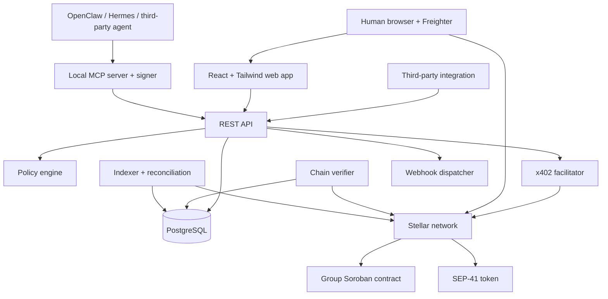

# Ledgerly

Shared expenses for humans and AI agents, settled directly on Stellar.

> **Status:** Draft · **Version:** 0.2 · **Target:** Stellar testnet MVP

Ledgerly is a non-custodial shared-expense ledger. Humans use a React web application connected to Freighter on Stellar testnet, while AI agents use the same capabilities through an HTTP API and a local MCP server. Expenses and balance deltas are committed to a Soroban contract; settlements transfer SEP-41 tokens directly from debtor to creditor.

Agents can settle through the Stellar `exact` x402 scheme. Ledgerly enforces spend policies before issuing a payment challenge, verifies the resulting transfer on-chain, and records the verified settlement in the group contract. Ledgerly and its contracts never hold user funds.

## Why Ledgerly?

Traditional expense-sharing products record debt but leave payment to users. They also do not provide safe, auditable participation for software agents. Ledgerly combines:

- expense tracking for groups of 2–20 humans and agents;
- direct settlement in USDC or another SEP-41 token;
- verifiable expense hashes, balance deltas, and settlements on Soroban;
- MCP and REST interfaces for agents and third-party builders;
- server-side agent caps, allowlists, approvals, audit logs, and revocation;
- x402-paid settlements and metered API access; and
- supply-chain and repository security as first-class requirements.

## Current scope

The first milestone is a testnet MVP supporting:

1. group creation and Stellar address verification;
2. equal and exact expense splits;
3. balance calculation from append-only expenses and settlements;
4. human settlement through the group contract;
5. one OpenClaw agent settling through x402 and the MCP server;
6. on-chain verification, indexing, and reconciliation; and
7. the repository and release security baseline.

Mainnet is explicitly gated behind contract verification, multisig administration, an upgrade timelock, security review, hardened release provenance, and a successful low-value owner settlement.

## Architecture at a glance



### Trust boundaries

- **Human keys** remain in Freighter. The web app requests signatures but never receives or stores a secret key.
- **Agent keys** remain in the MCP server process on the agent host; they are not exposed to the model or Ledgerly API.
- **Funds** move directly between members. Ledgerly, the facilitator, and the group contract do not custody them.
- **The database** supports queries but is not the source of truth for balances.
- **The facilitator** is not trusted for payment integrity; every settlement is independently checked against Stellar RPC.
- **Agent behavior** is considered untrusted. Policies are enforced by the API and, where possible, on-chain.

See [`docs/ARCHITECTURE.md`](docs/ARCHITECTURE.md) for component boundaries, data flow, dependency rules, and the complete repository map.

## Repository structure

```text
.
├── apps/
│   ├── web/                         # React SSR UI and Tailwind CSS
│   │   └── src/wallets/freighter/   # Testnet wallet adapter and signing boundary
│   ├── api/                         # JavaScript REST API, auth, and x402 resources
│   └── workers/
│       ├── chain-verifier/          # Confirms Stellar transfers before finality
│       ├── indexer/                 # Indexes contract events and reconciles state
│       └── webhook-dispatcher/      # Signs, retries, and records webhook delivery
├── packages/
│   ├── policy-engine/               # Pure agent policy evaluation
│   ├── shared/                      # Shared schemas, IDs, errors, and domain types
│   ├── stellar/                     # Stellar RPC, transaction, and contract adapters
│   └── x402/                        # Isolated x402 client/server integration
├── mcp-server/                      # Agent-side tools and signer boundary
├── contracts/
│   └── group-ledger/                # Non-custodial Soroban group contract
├── database/
│   └── migrations/                  # Ordered PostgreSQL schema migrations
├── openapi/                         # OpenAPI 3.1 source and generated artifacts
├── docs/
│   ├── adr/                         # Architecture decision records
│   └── runbooks/                    # Operational and incident procedures
├── deploy/
│   ├── docker/                      # Local/self-hosted container deployment
│   └── stellar/                     # Idempotent contract deployment scripts
├── tests/
│   ├── integration/                 # Cross-service and chain integration tests
│   ├── e2e/
│   │   └── freighter/               # Opt-in browser flows on Stellar testnet
│   └── fixtures/
│       └── freighter/               # Mocked wallet states and responses
├── supply-chain/                    # Version policy, checks, keys, and exemptions
├── scripts/                         # Repository-level development utilities
└── .github/workflows/               # Pinned CI, security, and release workflows
```

## Core design rules

1. **Append-only ledger:** expenses are never mutated; corrections reference prior expenses.
2. **Exact money types:** public amounts are decimal strings and internal amounts use token smallest units—never floating point.
3. **Zero-sum accounting:** each expense's balance deltas and every group's net balances sum to zero.
4. **Non-custodial settlement:** the contract's token balance must remain zero.
5. **Verify before finality:** x402 settlements remain `submitted` until RPC verification confirms network, asset, payer, payee, and amount.
6. **Policy before challenge:** agent policy is checked before any `402 Payment Required` response is issued.
7. **No free-form recipients:** agent settlement recipients must be verified members allowed by the agent policy.
8. **Idempotency everywhere:** mutation endpoints and settlement recording are replay-safe.
9. **Minimal shared code:** business rules live in domain packages; apps own transport and presentation concerns.
10. **Testnet-only wallet:** Freighter signing fails closed unless the active network is Stellar testnet.
11. **Pinned supply chain:** manifests, toolchains, actions, and images use reviewed exact versions and committed lockfiles.

## Planned technology

- **Application language:** Modern JavaScript using ES modules on a pinned current Node.js LTS release
- **Web UI:** React with server rendering and minimal client hydration
- **Web styling:** Tailwind CSS, compiled at build time from project-owned design tokens and reusable React components
- **Testnet wallet:** Freighter, isolated behind a web wallet adapter with explicit Stellar testnet checks
- **Type safety:** JSDoc for editor/static analysis plus runtime validation at every external boundary
- **Contract:** Rust, `soroban-sdk`, and WASM
- **Database:** PostgreSQL
- **Payments:** Stellar SEP-41 assets and x402 v2 `exact`
- **Agent interface:** Model Context Protocol over stdio and streamable HTTP
- **Observability:** structured logs, metrics, and OpenTelemetry traces
- **Deployment:** containerized services with a single self-hosted Compose profile

JavaScript source files use `.js` and ES module syntax. React renders the human interface, with server-rendered HTML as the default and client hydration limited to wallet interaction and genuinely interactive features. Tailwind utility classes should be composed through reusable React components rather than copied into large route modules.

For the MVP, Freighter is the supported human wallet on Stellar testnet. Before requesting any signature, the wallet adapter must confirm Freighter is installed and available, obtain the public address with user consent, and reject a network that is not Stellar testnet. The application never asks for or handles a wallet secret key.

The React server-rendering framework and exact React, Freighter API, Tailwind, package, and toolchain versions will be added only after they are checked against the project's cooldown and vulnerability policy. This initial scaffold intentionally does not invent dependency pins.

## Development status

This repository currently contains the project architecture only. Application manifests, implementation code, migrations, contracts, and CI workflows are not yet present.

The recommended implementation order is:

1. establish the Phase 0 repository and supply-chain controls;
2. define shared domain schemas and accounting invariants;
3. implement and test the group contract;
4. add the database, API, indexer, verifier, and reconciliation flow;
5. implement the web settlement flow;
6. add the x402 adapter and local MCP server; and
7. run the complete OpenClaw testnet acceptance flow.

## Security

Ledgerly assumes agents can be prompt-injected and external infrastructure can fail or misbehave. No payment authorization depends on model compliance. The planned security baseline includes:

- owner-controlled agent permissions, caps, approvals, allowlists, and kill switch;
- scoped, revocable API credentials stored as hashes;
- independent on-chain transaction verification;
- Soroban invariant, property, fuzz, and static-analysis tests;
- signed commits, tags, artifacts, SBOMs, and build provenance;
- exact dependency pins, lockfiles, release cooldowns, and vulnerability checks; and
- least-privilege CI permissions with actions pinned by full commit SHA.

Do not use this draft on mainnet or with funds of value. A `SECURITY.md` and private vulnerability reporting process will be added during Phase 0 before implementation begins.

## Contributing

The contribution workflow will be formalized during Phase 0. Until then:

- use a branch and pull request; do not push directly to `main`;
- keep changes focused and include tests for behavior changes;
- do not commit secrets, Stellar seeds, payment signatures, or private user data;
- do not add unpinned dependencies or GitHub Actions; and
- document significant design choices in `docs/adr/`.

## License

Licensed under the [MIT License](LICENSE).
