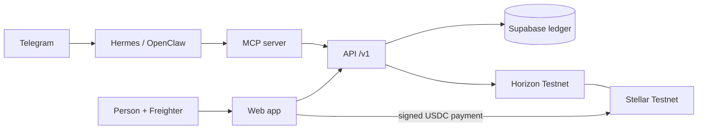

# Stellar-Split

Split shared expenses and settle them in USDC (or EURC, for euro groups) on Stellar, built for families and workers who send money across borders, with agent support via x402.

Built at HackMeridian (Lisbon, 25 to 26 October 2026). Track: Genesis, with Stellar Composed.

> **Status: hackathon build, Stellar Testnet only.** The web app, the group contract, the MCP server for agents and the API run today; see [What works today](#what-works-today). No real money is involved and nothing here is financial advice.

**Live:** https://stellar-split-sooty.vercel.app (API health: [`/v1/health`](https://stellar-split-sooty.vercel.app/v1/health))

## For the judges

| What | Link |
|---|---|
| The app (live, Testnet, built for your phone) | https://stellar-split-sooty.vercel.app |
| Product website | https://stellar-split-site.vercel.app |
| Developer docs: API, integrations, agents and MCP | https://stellar-split-docs.vercel.app |
| API health | https://stellar-split-sooty.vercel.app/v1/health |
| How we map to the judging criteria | [docs/JUDGING.md](docs/JUDGING.md) |

No wallet? Open the app and choose the demo: the whole app runs on sample data, without Freighter and without touching Stellar. With Freighter on Testnet you can settle real Testnet USDC and see the transaction on Stellar Expert.

The app, the website and the docs are three separate Vercel deployments. The website and the docs live in [`sites/landing`](sites/landing) and [`sites/docs`](sites/docs) as static files and do not change the app.

## Summary

Shared-expense apps record who owes whom, but the money still moves outside the app. Stellar-Split keeps the ledger and the settlement together: a group records expenses, sees who owes whom, and settles in USDC on Stellar. Money goes directly from the person who owes to the person owed. The app never holds user funds.

## Problem

Many people support family across borders or are paid in a way that makes cashing out difficult. Sending money is often costly and slow, and splitting a shared cost, such as rent paid with money sent from family, happens by hand.

Context from public sources (to be checked before the pitch; see `docs/BUILD-FOCUS.md`):

- Remittances to Mexico reached a record $64.7bn in 2024 and fell about 5% in 2025, the biggest drop since 2009 ([FXC Intelligence](https://www.fxcintel.com/research/analysis/us-mexico-remittances-2025)).
- A 1% US tax on remittances funded by cash, money orders or cashier's cheques started on 1 January 2026. Transfers funded from a bank account or card are exempt ([BBVA Research](https://www.bbvaresearch.com/en/publicaciones/mexico-2026-begins-with-new-remittance-tax/)).
- Stablecoin remittance flows on Stellar already exist, for example Felix Pago with Bitso using USDC ([Stellar case study](https://stellar.org/felix-bitso)).

## What works today

| Part | Where | Status |
|---|---|---|
| Web app: Freighter sign-in, groups, equal and exact splits, balances, settle in Testnet USDC (or EURC for a euro group) with the tx on Stellar Expert | [`apps/web`](apps/web/README.md) | Live at the URL above, talking to the API. Stellar Assist (the agent screens) runs on labelled sample data (“Preview”) until the agent API exists |
| API: sign-in with a signed message, groups, members, expenses, balances, two-step settlements (a reserved intent, then the payment with its memo) recorded only after Horizon confirms it | [`apps/api`](apps/api/README.md) | Live at the URL above, with Supabase |
| Shared money, split and balance rules used by both | [`packages/shared`](packages/shared/README.md) | Merged |
| Non-custodial Soroban group contract | [`contracts/group`](contracts/README.md) | Deployed on Testnet (below) |
| MCP server for agents: groups, balances, expenses, settlement proposals. It cannot move money | [`mcp`](docs/AGENT-INTERFACE.md) | Merged, not yet connected to the agents |
| Hermes Agent and OpenClaw on Telegram | [`docs/AGENTS.md`](docs/AGENTS.md) | Running for the team; payments are the stretch goal |
| Demo accounts: funded Testnet accounts with a USDC trustline and Testnet USDC, without a faucet | [`scripts/demo-accounts`](scripts/demo-accounts/README.md) | Merged |

### Testnet evidence

All are Testnet USDC payments signed in Freighter (or a test wallet) and sent by the web app, straight from the debtor to the creditor.

| What it shows | Transaction |
|---|---|
| A payment from the web app | [7e15141b…](https://stellar.expert/explorer/testnet/tx/7e15141b4fa3484aa319efcc783a81df6e35ab5d77dfb0576d8c38e80af576de) (1.50 USDC) |
| A partial payment from the review screen | [fee0d278…](https://stellar.expert/explorer/testnet/tx/fee0d278e996b207c1998a60959bf85d2bf7dd0621b0b0e6376d9dd2d24d4099) (1.00 USDC) |
| A payment the API verified on Horizon before recording it | [bd22e9a8…](https://stellar.expert/explorer/testnet/tx/bd22e9a86050c2a720b40cc950b4e0480f264b32ac029175d1c43633ab12efd5) (0.30 USDC) |
| A two-step settlement: the payment carries its reserved intent as a `MEMO_HASH` and expires with it, and the API recorded it after checking both | [6993c304…](https://stellar.expert/explorer/testnet/tx/6993c3042f956330e68e7196b673128aad4e9b9582b9e28fb70b886245ef3f62) (0.20 USDC) |

The plan, what is deferred and the submission checklist are in [`docs/BUILD-FOCUS.md`](docs/BUILD-FOCUS.md). The design is in [`docs/ARCHITECTURE.md`](docs/ARCHITECTURE.md).

## Architecture



- Freighter signs everything a person sends, so the app never sees a secret key. The payment goes straight from the debtor to the creditor.
- Paying is two steps. The API first reserves a settlement intent, which blocks other payments between the same people. The payment then carries the intent as a `MEMO_HASH` and expires with it. The API records it only after Horizon shows a successful USDC payment with the right payer, payee, amount, memo and time bounds, so an older payment cannot settle a new debt.
- The off-chain ledger is Supabase (PostgreSQL). The Soroban group contract is deployed; settling through its `settle` function comes after the plain transfer.
- Agents reach the ledger only through the MCP server. Agent payments through x402 are the stretch goal.
- Stack: JavaScript (ES modules, JSDoc), Vite + React + Tailwind CSS, Node.js with no runtime dependencies in the API, Supabase.

### Deployed on Stellar Testnet

| Item | Value |
|---|---|
| Group contract | [`CAZDOCJJR3NU5O2N44KQSWUG7C4OBLC6PIQLBFVPXODAYHHITFU7FR3Y`](https://stellar.expert/explorer/testnet/contract/CAZDOCJJR3NU5O2N44KQSWUG7C4OBLC6PIQLBFVPXODAYHHITFU7FR3Y) |
| Deploy transaction | [`56a42289…095fbe6a`](https://stellar.expert/explorer/testnet/tx/56a42289418586c90efec1a09ce36e70a152988067e2c7268fc9b2ec095fbe6a) (25 October 2026) |
| WASM hash | `ca6ba904c5759a963a3b08611a8d4519aa6a8e75670dacab873ace8fe27463e4` |
| Admin and recorder | `GCOURV2JXCIXK3CHXMJ4HBOPS5TMWGLL4AVKTO6A44DYYDJE2FA5I4N4` |
| Testnet USDC (Circle) | `USDC` issued by [`GBBD47IF6LWK7P7MDEVSCWR7DPUWV3NY3DTQEVFL4NAT4AQH3ZLLFLA5`](https://stellar.expert/explorer/testnet/asset/USDC-GBBD47IF6LWK7P7MDEVSCWR7DPUWV3NY3DTQEVFL4NAT4AQH3ZLLFLA5) (home domain `centre.io`), 7 decimals |
| Testnet USDC token contract | [`CBIELTK6YBZJU5UP2WWQEUCYKLPU6AUNZ2BQ4WWFEIE3USCIHMXQDAMA`](https://stellar.expert/explorer/testnet/contract/CBIELTK6YBZJU5UP2WWQEUCYKLPU6AUNZ2BQ4WWFEIE3USCIHMXQDAMA), the Stellar Asset Contract of that asset. Derived from the asset for the Testnet passphrase; the contract answers `name` = `USDC:GBBD47…` and `decimals` = 7 |

Group 1 on this contract is a smoke test that uses native XLM, not USDC. The demo settles with plain USDC payments (see [Testnet evidence](#testnet-evidence)); settling through the contract's `settle` comes later.

## Setup

Node.js 24 for the web app, 22 or later for the API and the MCP server.

```sh
cd apps/web && npm ci --ignore-scripts && cp .env.example .env && npm run dev   # http://localhost:5173
cd apps/api && cp .env.example .env && node --env-file=.env src/main.js         # http://localhost:8080
cd mcp && npm ci --ignore-scripts && npm test
cd contracts && cargo test
```

Each part documents its own variables: [`apps/web`](apps/web/README.md#environment-variables), [`apps/api`](apps/api/README.md) (`apps/api/.env.example`) and [`mcp`](docs/AGENT-INTERFACE.md#run). Copy `.env.example` to `.env` and never commit `.env`. `VITE_` variables end up in the browser bundle, so they never hold a secret.

## Demo

The web app and the API run as one Vercel project. How it is built and deployed is in [`docs/DEPLOYMENT.md`](docs/DEPLOYMENT.md).

The three-minute demo script is in [`apps/web/README.md`](apps/web/README.md#demo-script-about-3-minutes). It needs two funded Testnet accounts with a USDC trustline in Freighter. [`scripts/demo-accounts`](scripts/demo-accounts/README.md) prepares them in about a minute. `fund <G address>` sends Testnet USDC to any Freighter account that has a trustline, without its secret key.

Three demo accounts are already set up in Freighter on Testnet, each with XLM from Friendbot, a USDC trustline and Testnet USDC. Their secret keys stay in Freighter and are not in this repository.

| Account | Address |
|---|---|
| Demo user 1 | [`GAZ2D6UYGDFFORAS3PXOEIZQLVS7ME6VYRANQJNLEELMYIAOUB4PY7NY`](https://stellar.expert/explorer/testnet/account/GAZ2D6UYGDFFORAS3PXOEIZQLVS7ME6VYRANQJNLEELMYIAOUB4PY7NY) |
| Demo user 2 | [`GCCEP6MCOGHOWGFHMHGB3LAJVTB7ZFDPGYBUI6BFCOUH3NPVM7RZNZZX`](https://stellar.expert/explorer/testnet/account/GCCEP6MCOGHOWGFHMHGB3LAJVTB7ZFDPGYBUI6BFCOUH3NPVM7RZNZZX) |
| Demo user 3 | [`GDNTRR7T5BS22ULN2YHYIRPLYJWZ7EIPWG5BWBWN2TC52UVYGONEXXLC`](https://stellar.expert/explorer/testnet/account/GDNTRR7T5BS22ULN2YHYIRPLYJWZ7EIPWG5BWBWN2TC52UVYGONEXXLC) |

Testnet USDC can also be requested at [faucet.circle.com](https://faucet.circle.com) (Stellar Testnet), with a cooldown of about two hours per address.

### Settling in euros (EURC, #98)

A group settles in one asset, chosen when it is created: USDC (the default, and what every existing group uses) or EURC, Circle's euro stablecoin. Euro groups show € and "EURC" throughout, the payment and the API's check on Horizon use EURC, and balances in euros are never added to balances in dollars (the group list totals them separately).

EURC is off until it is configured, so nothing changes for the live demo until then:

1. Set `EURC_ISSUER` for the API and `VITE_EURC_ISSUER` for the web app to Circle's **Testnet** EURC issuer (`GB3Q6QDZYTHWT7E5PVS3W7FUT5GVAFC5KSZFFLPU25GO7VTC3NM2ZTVO`; the mainnet issuer is a different address).
2. Run [`database/migrations/003_group_asset.sql`](database/migrations/003_group_asset.sql) in Supabase (adds `groups.asset`; groups without a value stay USDC).
3. Each wallet needs a EURC trustline (Settle up offers **Add EURC trustline**) and Testnet EURC from [faucet.circle.com](https://faucet.circle.com) (choose Stellar Testnet and EURC).

Agent spend limits and the policy engine count in the group's own asset units. Settlement through the Soroban contract is unchanged.

## Security

Enforced in code and CI today:

- **Testnet only.** The web app refuses another network, and the API refuses to start or verify against anything but Testnet.
- **No secret keys.** Freighter signs. The API and the MCP server refuse any input shaped like a Stellar secret seed before it is stored or logged.
- **Money as integers.** Amounts are decimal strings checked with BigInt stroops: positive, at most seven decimals, splits that add up.
- **Payments are verified.** A settlement is recorded once per transaction hash, after Horizon confirms it, and never for more than is owed.
- **Supply chain.** Every GitHub Action is pinned by commit SHA; Dependabot waits out a cooldown; dependency review, OSV-Scanner, CodeQL and a version guard against outdated or vulnerable versions run on every PR.
- **Agents** run in pinned containers, answer only the team on Telegram, and hold no keys. See [`docs/AGENTS.md`](docs/AGENTS.md).

Threat model and policies: [`docs/security`](docs/security/README.md).

## Docs

- [Product requirements](docs/PRD.md) (written under the working name Ledgerly)
- [Judging criteria](docs/JUDGING.md)
- [Build focus](docs/BUILD-FOCUS.md)
- [Architecture](docs/ARCHITECTURE.md)
- [Agents: setup and access](docs/AGENTS.md)
- [Agent interface (MCP)](docs/AGENT-INTERFACE.md) and [agent wallets](docs/AGENT-WALLETS.md)
- [Security: threat model and policies](docs/security/README.md)
- [Testing status](docs/TESTING.md)
- [Deployment on Vercel](docs/DEPLOYMENT.md)
- [Wallets: Freighter now, more later (roadmap)](docs/WALLETS.md)
- [Group contract](contracts/README.md)
- [Security policy](SECURITY.md)
- [Supply chain checks](supply-chain/README.md)

## Release signing key

Planned after the hackathon: release tags and artifacts will be signed with the owner's GPG key, and the key fingerprint will be published here and in `SECURITY.md`.

## Team

Michella Warren, Victor Estival, Damaris Castro, Viviana Andrango, Sofiia Varich.

## Licence

MIT. See [`LICENSE`](LICENSE).
