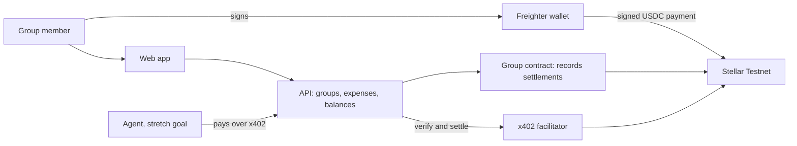

# Stellar Split (working name)

Split shared expenses and settle them in USDC on Stellar, built for families and workers who send money across borders, with agent support via x402.

Built at HackMeridian (Lisbon, 25 to 26 October 2026). Track: Genesis, with Stellar Composed.

> **Status: early stage, in active development.** A Soroban group contract and the supply-chain checks are in the repository. The web app and the end-to-end demo are being built during the event, and this README is updated as they land. Everything runs on **Stellar Testnet only**. No real money is involved and nothing here is financial advice.

## Summary

Shared-expense apps record who owes whom, but the money still moves outside the app. Stellar Split keeps the ledger and the settlement together: a group records expenses, sees who owes whom, and settles in USDC on Stellar. Money goes directly from the person who owes to the person owed. The app never holds user funds.

## Problem

Many people support family across borders or are paid in a way that makes cashing out difficult. Sending money is often costly and slow, and splitting a shared cost, such as rent paid with money sent from family, happens by hand.

Context from public sources (to be checked before the pitch; see `docs/BUILD-FOCUS.md`):

- Remittances to Mexico reached a record $64.7bn in 2024 and fell about 5% in 2025, the biggest drop since 2009 ([FXC Intelligence](https://www.fxcintel.com/research/analysis/us-mexico-remittances-2025)).
- A 1% US tax on remittances funded by cash, money orders or cashier's cheques started on 1 January 2026. Transfers funded from a bank account or card are exempt ([BBVA Research](https://www.bbvaresearch.com/en/publicaciones/mexico-2026-begins-with-new-remittance-tax/)).
- Stablecoin remittance flows on Stellar already exist, for example Felix Pago with Bitso using USDC ([Stellar case study](https://stellar.org/felix-bitso)).

## Planned scope for the hackathon

1. Create a group and connect a Freighter wallet.
2. Record expenses with equal or exact splits.
3. Show each member's balance.
4. Settle one real Testnet USDC payment, with the transaction hash shown.
5. Stretch: an agent settles through x402 within a spend cap.

The full plan, what is deferred, and the submission checklist are in [`docs/BUILD-FOCUS.md`](docs/BUILD-FOCUS.md).

## Architecture

- Web app with Freighter for signing, so the app never sees a secret key.
- API for groups, expenses and balances.
- Non-custodial Soroban group contract in `contracts/` (Rust) that records expenses and settlements. It never holds a token balance.
- Settlement in USDC on Stellar Testnet.
- x402 on Stellar (the `exact` scheme with a facilitator) for agent payments.

The full design is in [`docs/PRD.md`](docs/PRD.md). Contract IDs and assets will be listed here once confirmed.

| Item | Value |
|---|---|
| Network | Stellar Testnet |
| Settlement asset | USDC (Testnet) |
| Group contract ID | To be added |
| Example transaction | To be added |

## Setup

Setup steps for the web app will be added as it lands. The contract and its checks live in `contracts/`, and the repository checks are described in [`supply-chain/README.md`](supply-chain/README.md).

### Environment variables (planned)

Copy `.env.example` to `.env` when it exists. Never commit `.env`.

| Variable | Purpose |
|---|---|
| `STELLAR_NETWORK` | `testnet` |
| `HORIZON_URL` / `SOROBAN_RPC_URL` | Testnet endpoints |
| `X402_FACILITATOR_URL` | x402 facilitator for Testnet |
| `X402_FACILITATOR_API_KEY` | Facilitator key. Server-side only, never in the browser |

## Demo

Demo steps, the live URL and Testnet transaction evidence will be added here.

## Security

- Testnet only. The app refuses to act if the wallet is on another network.
- No secret keys are collected, stored or logged.
- Amounts are validated: positive, at most seven decimals, and within balance.
- Secrets live only in a local `.env`, which is ignored by git.
- Dependencies are pinned and checked in CI. See [`SECURITY.md`](SECURITY.md).

## Docs

- [Product requirements](docs/PRD.md)
- [Judging criteria](docs/JUDGING.md)
- [Build focus](docs/BUILD-FOCUS.md)
- [Security policy](SECURITY.md)
- [Supply chain checks](supply-chain/README.md)

## Release signing key

Release tags and artifacts will be signed with the owner's GPG key. The key fingerprint will be published here and in `SECURITY.md` with v0.1.0.

## Prior work disclosure

Before the event the team wrote a product requirements document (now v0.3, dated 25 October 2026) and reviewed public literature on remittances and stablecoins. No application code for this project was written before the event. A separate earlier Testnet prototype by Michella Warren, called Raven, is not part of this repository.

## Team

Michella Warren, Victor Estival, Damaris Castro, Viviana Andrango, Sofiia Varich.

## Licence

MIT. See [`LICENSE`](LICENSE).
