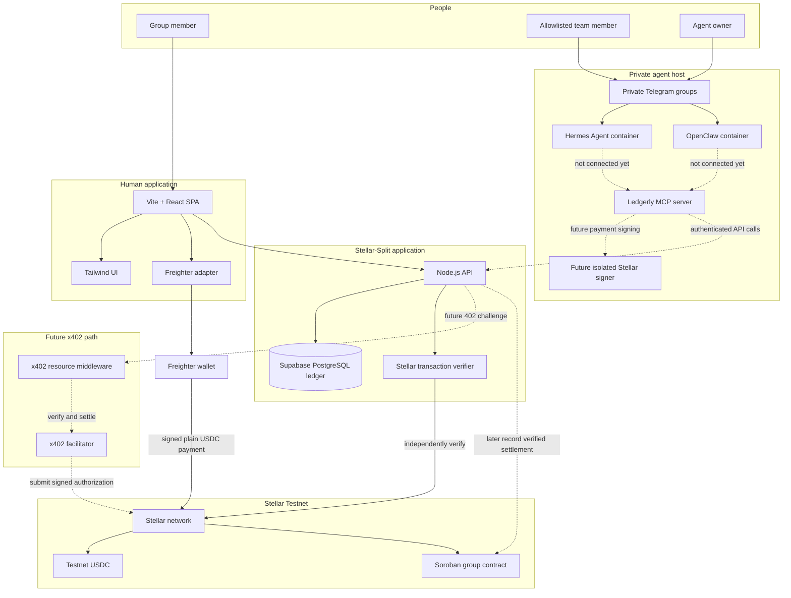
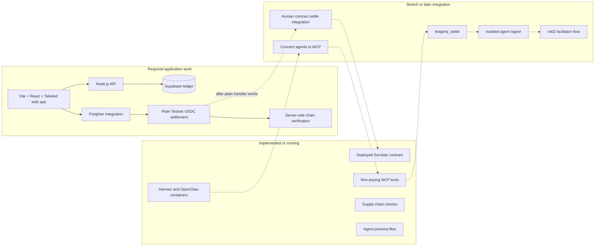
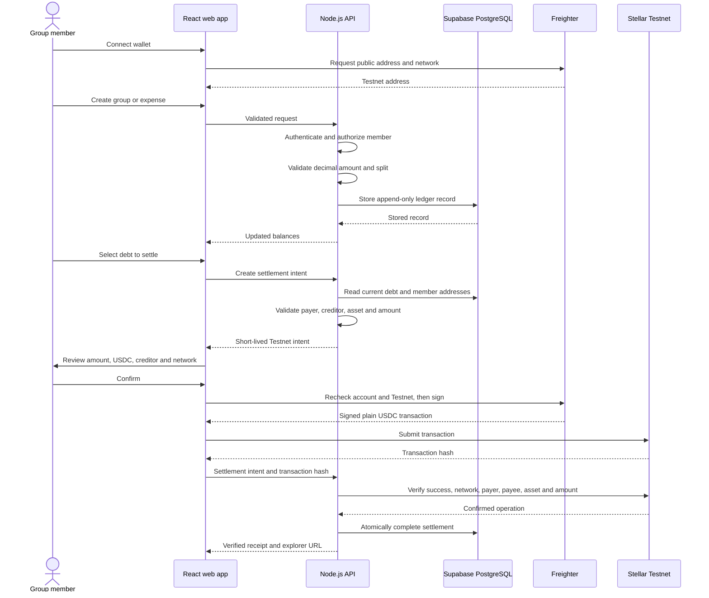
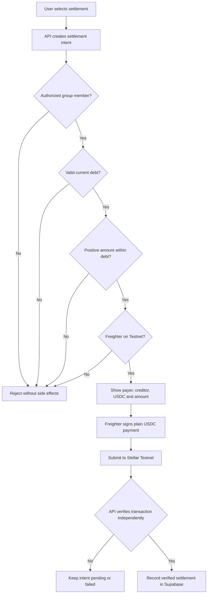
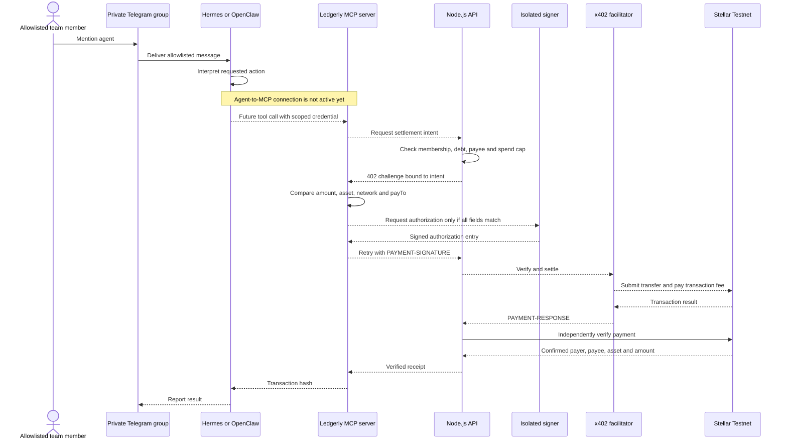
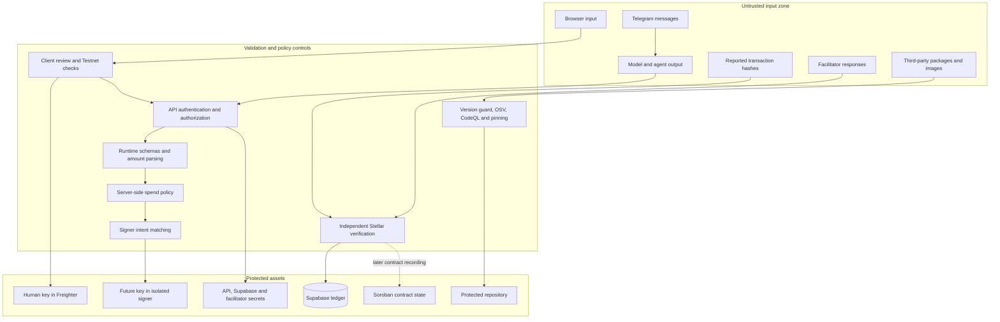
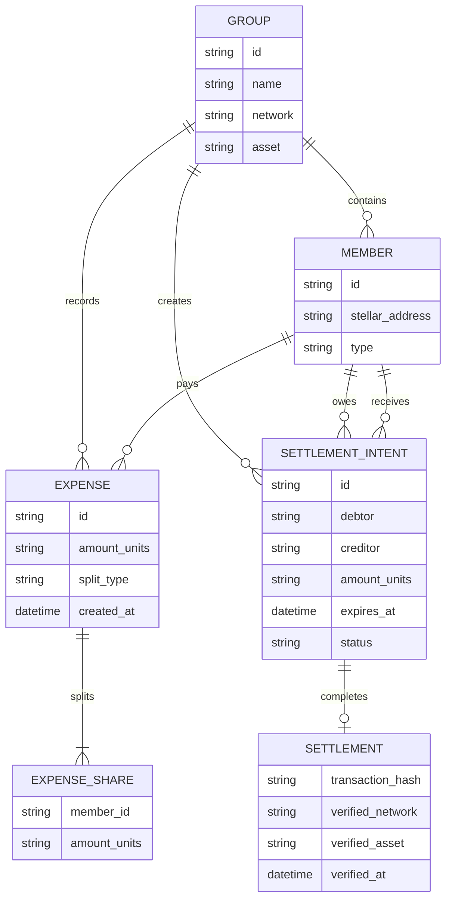
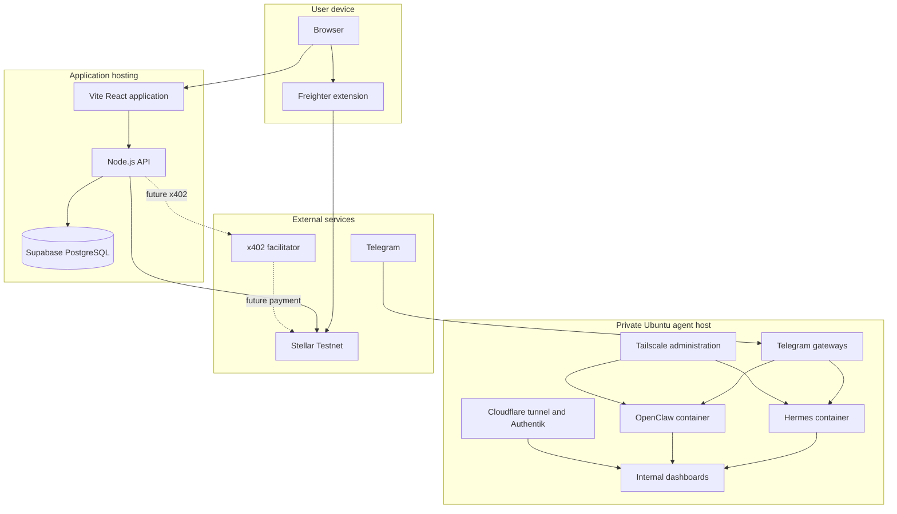
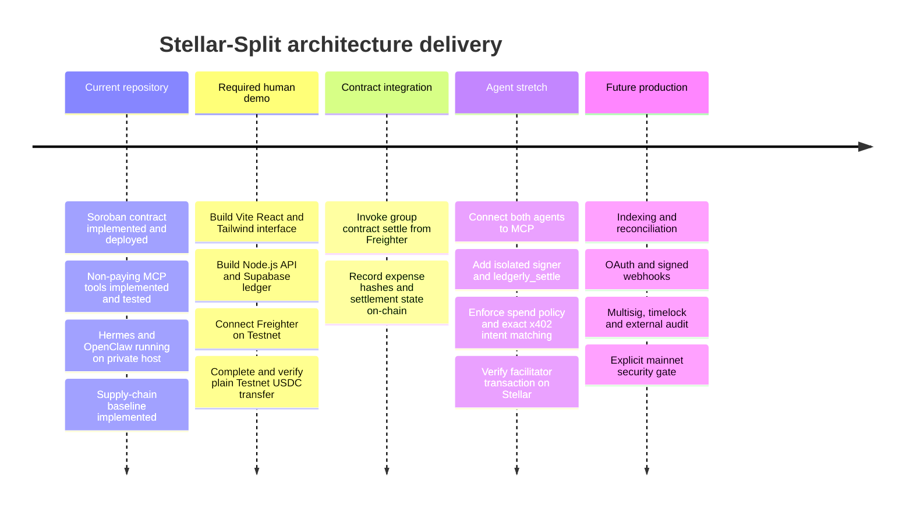

# Stellar-Split architecture visualization

> **Status:** Early-stage architecture · **Network:** Stellar Testnet only

This document visualizes the architecture described in [`ARCHITECTURE.md`](ARCHITECTURE.md), the hackathon priorities in [`BUILD-FOCUS.md`](BUILD-FOCUS.md), and the agent deployment in [`AGENTS.md`](AGENTS.md).

## Diagram legend

- Solid arrows show running connections or the required human-demo path.
- Dashed arrows show planned, deferred, or not-yet-connected integrations.
- The first required settlement is a plain Testnet USDC transfer signed with Freighter.
- Soroban contract settlement and signer-backed x402 payments follow after the human path works.

## 1. System overview

## 2. Current implementation status

The contract, MCP server, agents, and supply-chain controls exist. The web application and API directories currently provide architecture scaffolding. The agents answer allowlisted users through Telegram but are not connected to the MCP server.

## 3. Human expense and settlement flow

### Human settlement security gates

## 4. Agent access and future x402 settlement

The future signer belongs beside the MCP server, not inside Hermes or OpenClaw. The model never receives the Stellar secret key or unrestricted signing access.

## 5. Security 360 trust boundaries

### Security ownership by layer

| Layer | Trust decision | Primary controls |
|---|---|---|
| React application | What the user reviewed | Safe rendering, CSP, intent expiry, account and network change handling |
| Freighter | Whether the human authorizes a transaction | Secret-key isolation, user consent, Testnet verification before signing |
| Node.js API | Whether an action is permitted | Authentication, group authorization, runtime schemas, idempotency, rate limits |
| Supabase | Which records may be read or changed | Server-only service role, row-level security where browser access exists, constraints |
| Stellar verifier | Whether money actually moved as intended | Independent verification of network, payer, payee, asset, amount and status |
| Soroban contract | Whether on-chain balance changes follow contract rules | Debtor authorization, recorder restriction, zero-sum and duplicate protections |
| MCP server | Which agent tools may execute | Scoped credentials, minimal tools, input validation, no signer in the current version |
| Isolated signer | Whether an x402 authorization may be signed | Exact intent matching, key isolation, expiry and replay protection |
| Agent host | Who can reach the agents | Private groups, Telegram ID allowlists, Tailscale, Authentik, pinned containers |
| Repository and CI | What code and dependencies may ship | Protected branches, reviews, signed commits, pinned dependencies and automated scans |

## 6. Data ownership and authority

Authority is divided as follows:

- Supabase stores group metadata, append-only expenses, derived balance inputs, settlement intents, and verified transaction hashes for the first demo.
- Freighter controls the human wallet key and signature decision.
- Stellar Testnet is authoritative for payment finality.
- The deployed Soroban contract becomes authoritative for its own groups and balance records when contract integration is enabled.
- Agent persona files influence behavior but never authorize ledger or payment operations.

## 7. Deployment view

## 8. Delivery phases

## 9. Non-negotiable architecture rules

1. Everything remains on Stellar Testnet until the documented mainnet gate passes.
2. Human secret keys remain inside Freighter.
3. Agent keys must remain inside a separate signer process, never in the model or agent container.
4. A transaction hash is not proof of payment until the API verifies it on Stellar.
5. The first human settlement uses a plain Testnet USDC transfer.
6. The Soroban contract never holds user funds.
7. Supabase service-role credentials and facilitator credentials remain server-side.
8. Agent prompts and persona files are not authorization controls.
9. Every payment recipient comes from verified group membership, never free-form model output.
10. Mainnet, full x402 settlement, contract integration, workers, OAuth, and webhooks remain disabled until their required controls are implemented and tested.
