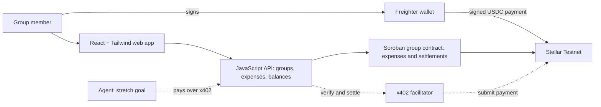

# Stellar Split architecture (working name)

> **Status:** Early stage, in active development · **Network:** Stellar Testnet only

This document translates the updated README from the `readme-update` branch into an implementation architecture for the HackMeridian build. It intentionally prioritizes the smallest complete demonstration: create a group, record expenses, calculate balances, and settle one real Testnet USDC payment through Freighter.

For product requirements, judging criteria, deferred work, and the submission checklist, refer to the corresponding documents under `docs/`, especially `docs/BUILD-FOCUS.md`.

## 1. Architecture principles

1. **Testnet only.** Every wallet, server, asset, contract, RPC, Horizon, explorer, and x402 operation must be configured for Stellar Testnet. Unknown or non-testnet configuration fails closed.
2. **Non-custodial.** User secret keys remain inside Freighter. Stellar Split never asks for, receives, stores, or logs a secret key.
3. **Direct settlement.** USDC moves from the member who owes money to the member who is owed. The application never holds user funds.
4. **Ledger plus payment.** Expenses create deterministic balances; successful Stellar payments reduce those balances and retain the transaction hash as evidence.
5. **Hackathon focus.** Human group, expense, balance, and settlement flows come before agent infrastructure.
6. **Agent support is a stretch goal.** x402 is isolated so an incomplete agent flow cannot destabilize the human demo.
7. **Simple boundaries.** React owns presentation, the API owns trusted validation and ledger rules, Freighter owns human signing, and Stellar owns payment finality.
8. **No unsupported claims.** Persistence, framework, contract, facilitator, and deployment details are documented as implemented only after they exist in the repository.

## 2. Scope and status

| Capability | Hackathon status | Required result |
|---|---|---|
| Connect Freighter | Required | Obtain the user's public address and confirm Stellar Testnet without exposing a secret key. |
| Create a group | Required | Create a shared-expense group with members identified by stable IDs and Stellar addresses. |
| Record an expense | Required | Support equal and exact splits with server-side validation. |
| Show balances | Required | Show what each member owes or is owed. |
| Settle in Testnet USDC | Required | Transfer USDC directly to the creditor and display the Stellar transaction hash. |
| Soroban group contract | Implemented in repository | Rust contract code records expenses and settlements without holding a token balance. Public contract ID and demo asset configuration remain to be confirmed. |
| Agent settlement through x402 | Stretch | Settle within a server-enforced spend cap through the Stellar `exact` scheme and a facilitator. |
| Mainnet | Out of scope | The application must refuse to operate on public network. |
| Production platform features | Deferred | MCP, approvals, webhooks, OAuth, indexing infrastructure, and other long-term product features are not hackathon requirements unless `BUILD-FOCUS.md` promotes them. |

## 3. System context



Solid lines represent the required human-demo architecture described by the updated README. Dashed lines represent the x402 stretch path. React and Tailwind are project technology decisions layered onto the README's web-app boundary.

## 4. Runtime components

### 4.1 React web application

**Location:** `apps/web`

The web application provides the human interface for:

- connecting Freighter;
- creating and viewing groups;
- adding equal or exact expenses;
- viewing member balances;
- reviewing a settlement before signing;
- submitting or relaying the signed Testnet transaction; and
- showing the final transaction hash with a testnet explorer link.

The web application uses:

- modern JavaScript with ES modules;
- React function components and hooks;
- Tailwind CSS for styling;
- server-rendering when supported by the selected framework; and
- minimal browser-only code outside wallet and interactive flows.

React components must not contain split arithmetic, balance derivation, network constants, or direct Freighter API calls.

Suggested layout:

```text
apps/web/src/
├── routes/                  # Page-level React route modules
├── components/              # Reusable accessible React + Tailwind primitives
├── features/
│   ├── groups/              # Group creation and member views
│   ├── expenses/            # Equal and exact expense forms
│   ├── balances/            # Per-member balance presentation
│   └── settlement/          # Review, sign, submit, and receipt UI
├── hooks/                   # React hooks for UI integrations
├── wallets/
│   └── freighter/           # The only Freighter integration boundary
├── client/                  # Browser entry and hydration
├── server/                  # SSR, API client, sessions, and headers
└── styles/                  # Tailwind entry point and design tokens
```

### 4.2 Freighter wallet adapter

**Location:** `apps/web/src/wallets/freighter`

Freighter is the wallet used for the testnet demo. The adapter owns all extension-specific behavior:

- detect whether Freighter is available;
- request permission to read the selected public address;
- read and normalize the active Stellar network;
- reject signing unless the active network is Testnet;
- request Soroban transaction or authorization-entry signing;
- normalize rejection, lock, account-change, and network-change errors; and
- invalidate a pending settlement when its account, network, or intent changes.

React features consume an application-owned adapter or wallet context. They do not import the Freighter API directly.

Before every signing request, the adapter must verify:

1. Freighter is available and unlocked;
2. the active account is the expected debtor address;
3. the active network is Stellar Testnet;
4. the operation transfers the expected Testnet USDC asset;
5. the amount is positive and has at most seven decimal places;
6. the destination is the selected creditor's registered address; and
7. the intent has not expired or already been submitted.

The user must see the amount, asset, creditor, and group before Freighter opens. The application never requests a secret key and never logs complete signed payloads.

### 4.3 JavaScript API

**Location:** `apps/api`

The API is the trusted application boundary for groups, expenses, balances, and settlement intents. It owns:

- input validation;
- group and member rules;
- expense split validation;
- deterministic balance calculation;
- settlement amount and creditor validation;
- transaction-hash intake and idempotency;
- chain verification before marking a settlement complete; and
- agent spend-cap enforcement if the x402 stretch flow is enabled.

Suggested layout:

```text
apps/api/src/
├── routes/
│   └── v1/
│       ├── groups/
│       ├── expenses/
│       ├── balances/
│       └── settlements/
├── domain/                  # Expense, split, balance, and settlement rules
├── repositories/            # Persistence boundary selected by the build
├── services/                # Use-case orchestration
├── middleware/              # Validation, errors, limits, and request IDs
├── stellar/                 # Server-side chain verification
└── observability/           # Safe structured logging
```

The README does not prescribe a database. Persistence must remain behind repository interfaces so the hackathon can use the simplest reliable option without coupling domain rules to it.

### 4.4 Shared domain modules

**Location:** `packages/shared`

Shared modules contain framework-independent rules and schemas:

- group, member, expense, split, balance, and settlement shapes;
- exact amount parsing and formatting;
- equal and exact split calculation;
- stable validation and error codes;
- transaction-hash and Stellar-address validation; and
- network and asset identifiers.

Use decimal strings at HTTP and UI boundaries. Convert amounts to integer stroops/token smallest units before arithmetic. Never use JavaScript floating-point values for balances or settlements.

### 4.5 Stellar integration

**Location:** `packages/stellar`

The Stellar module centralizes:

- Testnet network passphrase and endpoint validation;
- Testnet USDC asset or contract configuration;
- transaction construction and decoding;
- Soroban invocation helpers when the contract path is active;
- transaction submission strategy;
- transaction-status verification; and
- testnet explorer URLs.

Browser-safe transaction construction must be separated from server-only RPC or Horizon clients. A transaction hash reported by the browser is untrusted until the server confirms the network, asset, source, destination, amount, success status, and operation type.

### 4.6 Soroban group contract

**Location:** `contracts/group`

The group contract is implemented in Rust with `soroban-sdk` under `contracts/`. In line with the updated README, the public integration values are not considered confirmed until the README's architecture table is populated with the group contract ID, Testnet USDC asset, and example transaction.

The contract is non-custodial:

- settlement transfers USDC directly from debtor to creditor;
- the contract does not retain user funds;
- settlement authorization comes from the debtor;
- duplicate settlement records are rejected; and
- contract and asset IDs are explicit Testnet configuration.

The implemented interface is documented in `contracts/README.md`. The web and API must build against that interface rather than an assumed method shape. Repository code may contain deployment evidence, but the hackathon architecture must not present an ID or asset as the public demo configuration until the updated README confirms it.

### 4.7 x402 agent stretch path

**Location:** `packages/x402` and the relevant API route

The agent flow is isolated from the required human flow:

1. An agent requests a settlement intent from the API.
2. The API validates group membership, debt, recipient, amount, and spend cap.
3. If allowed, the API returns an x402 `402 Payment Required` challenge for Stellar Testnet using the `exact` scheme.
4. The agent retries with a signed payment payload.
5. The API asks the configured facilitator to verify and settle it.
6. The server verifies the resulting Testnet transaction before updating the ledger.

The facilitator API key is server-side only. Failure of the facilitator must not affect human expense and balance features.

A full MCP server, approval system, and general agent platform are deferred unless explicitly promoted into hackathon scope.

## 5. Core domain model

### Group

A collection of members sharing expenses. For the hackathon, each settling member has a Stellar public address.

### Member

A person or stretch-goal agent belonging to a group. Human settlement uses the member's Freighter-controlled address.

### Expense

An immutable record containing:

- payer;
- positive amount;
- description;
- participants;
- split type (`equal` or `exact`); and
- calculated shares.

### Balance

A derived value showing how much a member owes or is owed. Balances are calculated from expenses and completed settlements rather than manually edited.

### Settlement intent

A short-lived, idempotent instruction binding:

- group;
- debtor address;
- creditor address;
- Testnet USDC asset;
- amount in smallest units;
- Stellar Testnet network;
- expiry; and
- status.

### Settlement

A verified successful Stellar Testnet USDC payment associated with a settlement intent and transaction hash.

## 6. Accounting and validation rules

1. Amount input is a decimal string, positive, and no more than seven decimal places.
2. All arithmetic uses integer smallest units, never floating point.
3. Exact shares must sum exactly to the expense amount.
4. Equal-split remainders are assigned deterministically and documented in tests.
5. The payer cannot create value by participating in their own expense; all resulting balance deltas must sum to zero.
6. A settlement must be no greater than the debtor's current debt to that creditor unless the selected ledger model explicitly supports net group settlement.
7. A settlement reduces debt and never increases it.
8. A transaction hash can complete at most one settlement intent.
9. Browser reports and facilitator responses are not finality proofs; the API verifies the transaction against Stellar Testnet.

## 7. Human settlement flow


The web builds the transaction for the implemented contract's `settle(group, from, to, amount)` method, Freighter authorizes it, and the resulting transaction hash is verified before the UI marks settlement complete.

## 8. Data ownership

| Data | Authority |
|---|---|
| Group and member metadata | API persistence layer |
| Expense records | API persistence layer |
| Derived balances | Deterministically calculated from expenses and completed settlements |
| Wallet account and signatures | Freighter; secret material never enters the application |
| Payment finality | Stellar Testnet |
| Settlement receipt | Verified Stellar transaction plus API association to an intent |
| Group membership, expense hashes, balances and settlement records | Soroban group contract; public Testnet integration details pending confirmation |
| Agent spend cap, when enabled | API policy state |

## 9. Configuration

The root `.env.example` documents names and safe Testnet defaults only. Contract, asset and facilitator values remain blank until the public demo integration is confirmed.

| Variable | Runtime | Purpose |
|---|---|---|
| `STELLAR_NETWORK` | Shared/public | Must equal `testnet`. |
| `HORIZON_URL` | Server or public when required | Approved Stellar Testnet Horizon endpoint. |
| `SOROBAN_RPC_URL` | Server or public when required | Approved Stellar Testnet RPC endpoint. |
| `USDC_ASSET_CODE` / `USDC_ISSUER` or token contract ID | Shared/public | Exact Testnet USDC identity used by the demo. |
| `GROUP_CONTRACT_ID` | Shared/public | Confirmed Testnet group contract ID; required before the public demo and intentionally not asserted here while the updated README says `To be added`. |
| `X402_FACILITATOR_URL` | Server, stretch | Testnet-capable facilitator endpoint. |
| `X402_FACILITATOR_API_KEY` | Server secret, stretch | Facilitator credential; never exposed to browser code. |

Configuration validation must reject public-network passphrases, endpoints, assets, and contract IDs. Do not rely only on the variable name `STELLAR_NETWORK`; validate the actual transaction network and configured resources.

## 10. Testing strategy

| Layer | Focus |
|---|---|
| Domain unit tests | Equal and exact splits, seven-decimal limits, zero-sum balances, partial settlement, overpayment rejection, and idempotency. |
| React component tests | Group and expense forms, balance views, settlement review, loading, error, and receipt states. |
| Freighter adapter tests | Missing extension, locked wallet, rejection, wrong network, account change, network change, stale intent, and successful signature. |
| API integration tests | Group/expense persistence, balance derivation, settlement intent validation, and transaction-hash replay. |
| Stellar integration tests | Transaction building and verification against deterministic fixtures or Testnet. |
| End-to-end test | Connect Freighter, record expenses, settle Testnet USDC, and display a resolvable transaction hash. |
| x402 stretch test | Enforce the spend cap, settle through the facilitator, and verify the resulting Testnet transfer. |
| Contract tests | Authorization, direct transfer, no retained funds, duplicate prevention, and amount boundaries when contract integration is active. |

Network-dependent tests are opt-in and Testnet-only. No test command may default to public network.

## 11. Security boundaries

- The browser may hold public addresses, unsigned intents, and short-lived signed results needed for submission; it never handles secret keys.
- Freighter is trusted to protect the user's key and present signing consent.
- Browser input and transaction hashes are untrusted by the API.
- The API validates authorization, amounts, splits, balances, recipients, and settlement evidence.
- The facilitator is not trusted as final evidence; x402 results are independently verified on Stellar Testnet.
- Logs exclude secrets, complete signed payloads, authentication tokens, and facilitator credentials.
- Local secrets live in ignored `.env` files or an equivalent secret store.
- The application presents no mainnet option and fails closed on network mismatch.

## 12. Repository map

The hackathon-focused ownership map is:

```text
.
├── apps/
│   ├── web/                          # React, Tailwind, and Freighter UI
│   └── api/                          # Groups, expenses, balances, settlements
├── packages/
│   ├── shared/                       # Domain rules and runtime schemas
│   ├── stellar/                      # Testnet transaction and verification helpers
│   └── x402/                         # Isolated agent stretch integration
├── contracts/
│   └── group/                        # Implemented Soroban contract; demo integration pending
├── tests/
│   ├── integration/
│   ├── e2e/
│   │   └── freighter/
│   └── fixtures/
│       └── freighter/
├── docs/
│   ├── ARCHITECTURE.md
│   └── BUILD-FOCUS.md
├── scripts/                          # Build, validation, and deployment utilities
├── supply-chain/                     # Dependency and release controls
└── .github/                          # CI and dependency automation
```

Existing directories for long-term workers, MCP, policy, webhooks, or database infrastructure should be treated as deferred scaffolding unless the current `BUILD-FOCUS.md` explicitly includes them.

## 13. Demo acceptance path

The architecture is successful when the team can demonstrate this uninterrupted flow:

1. Open the React web application.
2. Connect Freighter on Stellar Testnet.
3. Create a group with at least two members.
4. Record one equal-split expense.
5. Record one exact-split expense.
6. Show the resulting member balances.
7. Select a valid debt and review a Testnet USDC settlement.
8. Sign with Freighter without exposing a secret key.
9. Submit and independently verify the Stellar transaction.
10. Show the successful transaction hash and testnet explorer link.
11. If the stretch goal is ready, show an agent settlement through x402 that remains inside its spend cap.

## 14. Decisions that must match the repository

Before implementation documentation is considered final, verify and record:

1. the selected React build/server-rendering framework;
2. exact reviewed React, Tailwind, Freighter, and Stellar package versions;
3. the persistence mechanism used by the API;
4. the official Testnet USDC identifier;
5. the confirmed Testnet group contract ID and USDC asset used by the demo;
6. whether the browser or API submits signed human transactions;
7. the testnet explorer URL format;
8. the facilitator selected for the x402 stretch flow; and
9. the live demo URL and verified transaction evidence.
