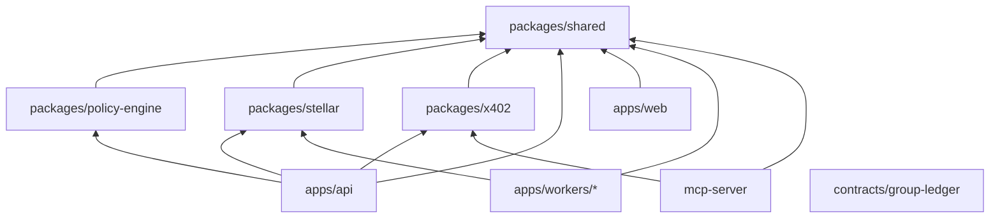
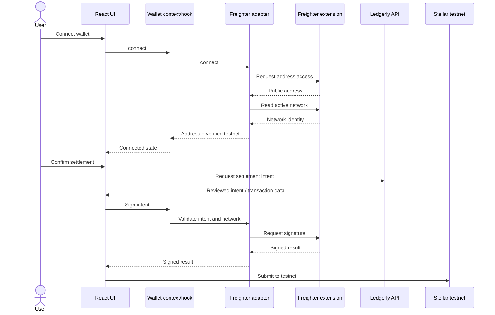
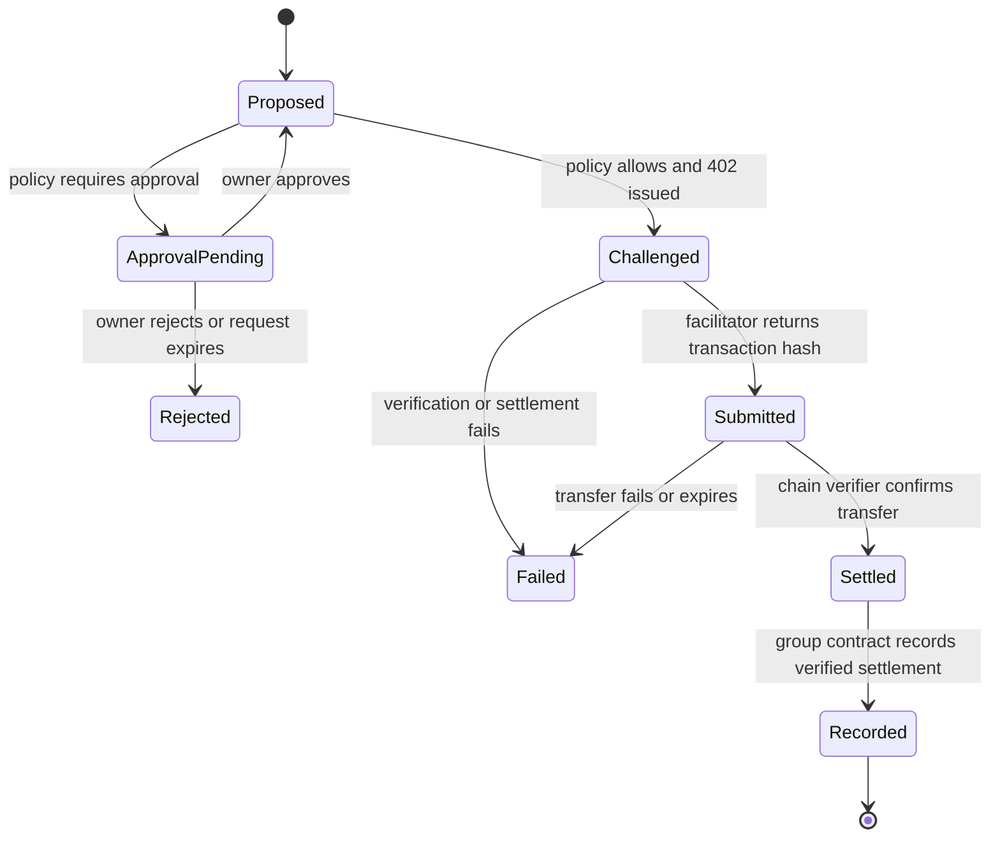

# Ledgerly architecture

This document defines the intended module boundaries for Ledgerly. It is a scaffold-level design: directories exist, but implementation and dependency choices remain to be pinned and reviewed.

## System boundaries

Ledgerly consists of four independently deployable application surfaces:

| Surface | Location | Responsibility |
|---|---|---|
| Human application | `apps/web` | Server-rendered React UI styled with Tailwind CSS. Connects to Freighter on testnet and delegates domain mutations to the API. |
| Resource server | `apps/api` | Authentication, authorization, REST endpoints, idempotency, policy enforcement, and x402 payment challenges. |
| Background workers | `apps/workers` | Chain verification, event indexing/reconciliation, and webhook delivery. Each worker can scale and fail independently. |
| Agent gateway | `mcp-server` | Runs on the agent host, exposes constrained MCP tools, owns the agent signer, validates 402 terms, and signs only matching authorization entries. |

The web app, API, workers, shared packages, and MCP server use modern JavaScript with ES modules. The web UI uses React and Tailwind CSS, with Freighter as the supported human wallet for the testnet MVP. The Soroban group contract under `contracts/group-ledger` remains Rust and is a separate trust boundary and release artifact.

## Dependency direction



Rules:

- `packages/shared` must not import an app or infrastructure adapter.
- `packages/policy-engine` remains a deterministic, side-effect-free domain package.
- Apps may compose packages, but apps must not import one another's internals.
- Workers communicate through durable database/outbox state, not direct in-process calls.
- Contract code does not share runtime code with Node.js packages; schemas are mirrored through explicit versioned interfaces and fixtures.
- JavaScript modules use ES module syntax, JSDoc for static analysis, and runtime schemas at HTTP, MCP, database, and chain boundaries.
- React and Tailwind are web presentation concerns and must not be imported by API, worker, MCP, or domain packages.
- Freighter SDK/API calls stay behind `apps/web/src/wallets/freighter`; components consume the wallet adapter rather than the extension API directly.
- x402-specific behavior stays behind `packages/x402` so protocol or facilitator changes have a narrow blast radius.

## Component layout

### `apps/web`

Owns React routes, server-rendered pages, forms, Freighter connection UI, Tailwind styles, accessibility, and browser security headers. It must not hold private keys or derive balances independently. Server-rendered React output is the default; client hydration is limited to Freighter and interactions that require browser state.

Suggested internal modules once implementation starts:

```text
apps/web/src/
├── routes/              # React route modules and page composition
├── components/          # Reusable accessible React + Tailwind primitives
├── features/            # Group, expense, balance, settlement, and agent UI
├── hooks/               # Browser-safe React hooks
├── wallets/
│   └── freighter/       # Detection, connection, network checks, and signing
├── client/              # Hydration entry and browser-only integrations
├── server/              # React SSR, sessions, API client, and headers
└── styles/
    └── app.css           # Tailwind import, theme tokens, and global layers
```

#### Freighter testnet adapter

`apps/web/src/wallets/freighter` is the only module allowed to communicate with Freighter. It exposes an application-owned interface rather than leaking extension-specific response objects into React:

- `isAvailable()` checks whether the wallet integration can be used;
- `connect()` requests access and returns the selected public address;
- `getNetwork()` returns normalized network identity;
- `assertTestnet()` blocks signing unless the active network is Stellar testnet;
- `signAuthEntry(intent)` signs a reviewed Soroban authorization entry; and
- `signTransaction(intent)` signs the human settlement transaction when the flow requires a full transaction.

The exact function signatures will be finalized against the pinned Freighter API release. React consumes this adapter through a wallet context and hooks; route components do not call Freighter directly.



Required safeguards:

1. Read the active network immediately before every signature request, not only at connection time.
2. Reject public network, futurenet, standalone, unknown, or missing network identities.
3. Display amount, asset, creditor, group, and operation before opening Freighter.
4. Treat address or network change as session invalidation and require the user to review the action again.
5. Do not auto-submit a stale signature after route navigation, intent expiry, or account change.
6. Keep mocked extension responses in `tests/fixtures/freighter`; end-to-end extension flows belong in `tests/e2e/freighter` and run only against testnet.

### `apps/api`

Owns JavaScript REST transport, authentication, request authorization, runtime schema validation, rate limiting, idempotency, orchestration, and transaction/outbox boundaries. Domain rules should be delegated to packages rather than embedded in handlers.

```text
apps/api/src/
├── routes/v1/
├── auth/
├── authorization/
├── domain/
├── repositories/
├── services/
├── middleware/
└── observability/
```

### `apps/workers`

- `chain-verifier`: verifies network, token contract, payer, payee, amount, and finality before marking a settlement complete; then queues contract recording.
- `indexer`: consumes contract events, maintains query projections, and performs scheduled reconciliation. A mismatch freezes settlement for the affected group.
- `webhook-dispatcher`: reads an outbox, signs timestamped HMAC payloads, retries with exponential backoff, and records delivery attempts.

### `packages/policy-engine`

A pure function from agent identity, permissions, spend history, group membership, proposed action, and current time to an explicit decision:

- `allow`;
- `deny` with a stable reason code; or
- `require_approval` with expiry and threshold metadata.

Time and spend history must be supplied as inputs to keep decisions deterministic and property-testable.

### `packages/shared`

Owns transport-independent domain contracts, ID constructors, JSDoc definitions, decimal/smallest-unit conversion rules, runtime validation schemas, event names, stable error codes, and canonical expense hashing rules. It must remain small and avoid becoming a generic utility dump.

### `packages/stellar`

Owns RPC and Horizon clients, network configuration, SEP-41 asset metadata, contract invocation builders, transaction parsing, explorer links, and chain verification primitives. Callers consume interfaces rather than vendor SDK objects.

### `packages/x402`

Owns resource-server middleware integration, facilitator clients, challenge construction, response parsing, and the agent-side validation/signing workflow. Settlement intent data must be bound to each challenge and checked before signing.

### `mcp-server`

Exposes only the documented tools:

- `ledgerly_list_groups`;
- `ledgerly_get_balances`;
- `ledgerly_create_expense`;
- `ledgerly_propose_settlement`;
- `ledgerly_settle`; and
- `ledgerly_get_approval`.

The signer is behind a narrow interface and never appears in tool input, output, logs, or model context. Read-only capabilities are the default.

### `contracts/group-ledger`

Owns group membership, expense commitments and balance deltas, direct human settlements, and verified x402 settlement records. Storage must avoid unbounded values in a single ledger entry.

Expected public capabilities:

- initialize and administer a group;
- add and remove eligible members;
- append an expense hash and zero-sum deltas;
- settle by directly invoking the configured SEP-41 token contract;
- record a uniquely identified x402 settlement; and
- pause or upgrade through controlled administration.

Required invariants include zero contract token balance, zero-sum group balances, non-increasing debt after settlement, unique recorded transaction hashes, checked arithmetic, and authorization on every privileged action.

## Data ownership

| Data | Authoritative source | Query copy |
|---|---|---|
| Expense details and attachments | PostgreSQL (append-only application records) | Same database |
| Expense hash and balance deltas | Group contract | Indexed PostgreSQL projection |
| Group balances | Derived contract state | Indexed PostgreSQL projection |
| Human settlement | Stellar transaction + contract record | PostgreSQL settlement projection |
| Agent x402 settlement | Verified SEP-41 transfer + contract record | PostgreSQL settlement projection |
| Agent policy and approvals | PostgreSQL | N/A |
| Webhook delivery | PostgreSQL outbox/delivery log | N/A |
| Idempotency result | PostgreSQL with 24-hour retention | N/A |

The database is authoritative for private metadata and workflow state, but not for on-chain balances or settlement proof.

## Settlement state machine



A response from the facilitator is not sufficient to mark a settlement `settled`. Independent RPC verification is mandatory.

## Expense write flow

1. Authenticate the actor and authorize membership/capability.
2. Validate the amount and split using decimal strings converted to smallest units.
3. Produce deterministic, zero-sum balance deltas.
4. Canonicalize and hash the immutable expense payload.
5. Persist private metadata, idempotency state, and an outbox command atomically.
6. Submit the hash and deltas to the group contract.
7. Index the emitted event and update the query projection.
8. Reconciliation periodically checks the projection against contract state.

Corrections are new records referencing the original expense; updates and destructive deletes are not valid ledger operations.

## Database and asynchronous work

Use PostgreSQL transactions and an outbox pattern for chain submissions, verification, and webhooks. Jobs require stable identifiers, bounded retries, dead-letter visibility, and idempotent handlers. No request should rely on an in-memory queue for durable work.

Migrations in `database/migrations` are ordered, immutable after release, and safe for rolling deployment. Data-access methods must enforce group scope at the query boundary.

## React, JavaScript, Tailwind, and wallet conventions

- Use `.js` files and standard ES module `import`/`export` syntax throughout Node.js and browser code.
- Use JSDoc on public APIs and domain values so editors and static checks can catch incorrect usage without adding a separate compilation step.
- Treat all external values as untrusted. JSDoc does not replace runtime validation for HTTP, MCP, environment, database, webhook, or chain data.
- Use React function components and hooks. Keep domain rules out of component state and route modules.
- Keep browser bundles small by server-rendering React pages and hydrating only interactive boundaries.
- Keep Tailwind configuration and the root stylesheet inside `apps/web`; shared domain packages must not depend on React, CSS, or UI concerns.
- Define colors, spacing, typography, focus states, and other project tokens centrally rather than scattering arbitrary values.
- Extract repeated interface patterns into accessible components. Do not use CSS abstraction solely to hide ordinary one-off utility classes.
- Tailwind production builds must scan only project source/templates and remove unused utilities. Generated class names must use an explicit safelist when dynamic composition is unavoidable.
- Meet WCAG 2.1 AA in component states, keyboard navigation, contrast, labels, errors, and focus visibility.
- Access Freighter only through the wallet adapter. React components must not call the extension API directly.
- Treat wallet availability, user rejection, locked state, account changes, and network changes as normal UI states with actionable messages.
- For the MVP, reject signing when Freighter is not connected to Stellar testnet. Never silently switch networks or fall back to public network.
- Bind every signing request to the expected testnet network, contract, operation, and human-readable intent; never request a blind signature.
- Never request, receive, persist, or log a Freighter secret key or complete signed payload.

## Configuration and secrets

Runtime configuration is environment-driven and validated at startup. A future root `.env.example` will contain names and safe descriptions only.

Never store:

- Stellar secret seeds;
- API key plaintext after initial issuance;
- wallet signatures or x402 payment payloads in logs;
- facilitator or webhook secrets in source control; or
- production credentials in test fixtures.

Human signing remains in wallets. Agent signing remains in the local MCP server. Contract admin keys remain offline and are not API runtime secrets.

## Testing layers

| Layer | Location | Focus |
|---|---|---|
| Unit | Beside source | Split arithmetic, canonical hashes, policy decisions, React components/hooks, wallet adapter states, validation, state transitions |
| Contract unit/property | `contracts/group-ledger/tests` | Public functions, authorization failures, boundary values, accounting invariants |
| Contract fuzz | `contracts/group-ledger/fuzz` | Settlement and balance invariants under generated action sequences |
| Integration | `tests/integration` | PostgreSQL, RPC adapters, facilitator boundary, outbox jobs, contract events |
| End-to-end | `tests/e2e` | Freighter human-wallet and OpenClaw/Hermes acceptance flows on testnet |
| Fixtures | `tests/fixtures` | Deterministic three-member/five-expense cases and chain responses |

Network-dependent tests must be clearly separated from deterministic tests. Freighter adapter unit tests use mocked extension responses; `tests/e2e/freighter` contains opt-in browser tests against Stellar testnet. No mainnet test may run by default, and test configuration must fail closed if a public-network passphrase or URL is supplied.

## Deployment model

The reference deployment is a containerized stack behind HTTPS:

- web and API services;
- PostgreSQL;
- chain verifier, indexer, and webhook workers;
- optional observability services; and
- an MCP server deployed separately beside each agent runtime.

`deploy/docker` will contain local and self-hosted definitions. `deploy/stellar` will contain idempotent testnet/mainnet contract scripts with an explicit mainnet confirmation gate.

## Repository security layout

`supply-chain` is reserved for the approved-version registry, dependency exemptions with expiry dates, version guard, action pin checker, Scorecard threshold checker, release public key, and their tests. `.github/workflows` will invoke those controls with least-privilege permissions and full-SHA action pins.

No placeholder workflow has been added because a fake SHA or unverified dependency version would contradict the project's security policy.

## Architecture decisions to record first

The first ADRs should cover:

1. JavaScript workspace/package manager and ES module conventions;
2. React server-rendering framework, hydration strategy, and Tailwind build integration;
3. Freighter adapter API, testnet network enforcement, and wallet test strategy;
4. PostgreSQL access and migration tooling;
5. canonical JSON and amount representation;
6. asynchronous job/outbox implementation;
7. Stellar RPC/indexing strategy;
8. x402 package and facilitator adapter boundaries; and
9. contract storage keys, TTL extension, and upgrade administration.
