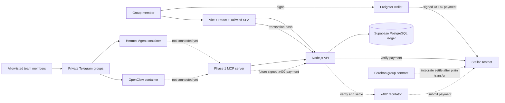
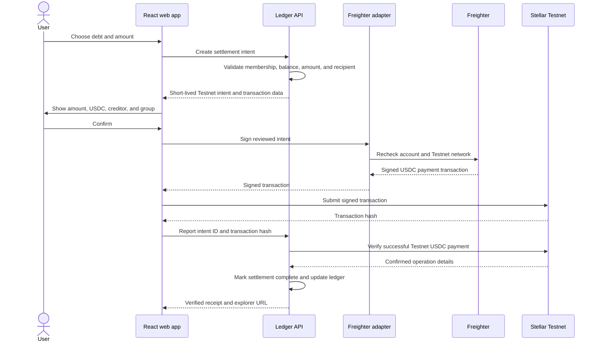

# Stellar-Split architecture

> **Status:** Early stage, in active development · **Network:** Stellar Testnet only

This document translates the current `main` README and merged repository documentation into an implementation architecture for the HackMeridian build. It intentionally prioritizes the smallest complete demonstration: create a group, record expenses, calculate balances, and settle one real Testnet USDC payment through Freighter.

For product requirements, judging criteria, deferred work, agent operations, and the submission checklist, refer to the corresponding documents under `docs/`, especially `docs/BUILD-FOCUS.md`, `docs/PRD.md`, and `docs/AGENTS.md`. Where the long-term PRD is broader than the hackathon cut, `docs/BUILD-FOCUS.md` controls implementation priority.

## 1. Architecture principles

1. **Testnet only.** Every wallet, server, asset, contract, RPC, Horizon, explorer, and x402 operation must be configured for Stellar Testnet. Unknown or non-testnet configuration fails closed.
2. **Non-custodial.** User secret keys remain inside Freighter. Stellar-Split never asks for, receives, stores, or logs a secret key.
3. **Direct settlement.** USDC moves from the member who owes money to the member who is owed. The application never holds user funds.
4. **Ledger plus payment.** Expenses create deterministic balances; successful Stellar payments reduce those balances and retain the transaction hash as evidence.
5. **Hackathon focus.** Human group, expense, balance, and settlement flows come before agent infrastructure.
6. **Agent support is a stretch goal.** x402 is isolated so an incomplete agent flow cannot destabilize the human demo.
7. **Simple boundaries.** React owns presentation, the API owns trusted validation and ledger rules, Freighter owns human signing, and Stellar owns payment finality.
8. **No unsupported claims.** Persistence, framework, contract, facilitator, and deployment details are documented as implemented only after they exist in the repository.

## 2. Scope and status

| Capability | Hackathon status | Required result |
|---|---|---|
| Connect Freighter | Required | Obtain the user's public address and confirm Stellar Testnet without exposing a secret key. |
| Create a group | Required | Create a shared-expense group with members identified by stable IDs and Stellar addresses. |
| Record an expense | Required | Support equal and exact splits with server-side validation. |
| Show balances | Required | Show what each member owes or is owed. |
| Settle in Testnet USDC | Required | Transfer USDC directly to the creditor and display the Stellar transaction hash. |
| Plain Testnet USDC settlement | Required first path | Freighter signs a direct payment, the API verifies it on Stellar and Supabase records the completed settlement. |
| Soroban group contract | Implemented and deployed; integration follows | Contract code and Testnet deployment are confirmed. Human `settle` integration follows after the plain-transfer demo works. |
| MCP read/create/propose tools | Implemented, not connected to agents | `mcp/` exposes non-paying tools for groups, balances, expenses, settlement proposals and approvals, but the hosted agents cannot call it yet. |
| Hermes and OpenClaw runtimes | Running, integration pending | Both Telegram agents run in separate pinned containers on the private agent host. Selected Phase 1a tests cover both agents, while payment remains a hackathon stretch goal. |
| Agent settlement through x402 | Stretch, not built | Add signer-backed `ledgerly_settle` within server-enforced limits after the human flow works. |
| Mainnet | Out of scope | The application must refuse to operate on public network. |
| Production platform features | Deferred | Paying MCP tools, full approval delivery, webhooks, OAuth, indexing infrastructure, and other long-term product features are not hackathon requirements unless `BUILD-FOCUS.md` promotes them. |

## 3. System context



Solid lines represent implemented boundaries, currently running agent access, or the required plain-transfer human demo. Dashed lines represent integrations that are not connected yet: contract settlement, agent-to-MCP access, and signer-backed x402 payment.

## 4. Runtime components

### 4.1 React web application

**Location:** `apps/web`

The web application provides the human interface for:

- connecting Freighter;
- creating and viewing groups;
- adding equal or exact expenses;
- viewing member balances;
- reviewing a settlement before signing;
- submitting or relaying the signed Testnet transaction; and
- showing the final transaction hash with a testnet explorer link.

The web application uses:

- Vite and modern JavaScript with ES modules and JSDoc;
- a React single-page application with function components and hooks;
- Tailwind CSS for styling; and
- client-side routing with browser-only wallet integration.

React components must not contain split arithmetic, balance derivation, network constants, or direct Freighter API calls.

Suggested layout:

```text
apps/web/src/
├── routes/                  # Page-level React route modules
├── components/              # Reusable accessible React + Tailwind primitives
├── features/
│   ├── groups/              # Group creation and member views
│   ├── expenses/            # Equal and exact expense forms
│   ├── balances/            # Per-member balance presentation
│   └── settlement/          # Review, sign, submit, and receipt UI
├── hooks/                   # React hooks for UI integrations
├── wallets/
│   └── freighter/           # The only Freighter integration boundary
├── client/                  # Vite browser entry
├── api/                     # HTTP client for the Node.js API
└── styles/                  # Tailwind entry point and design tokens
```

### 4.2 Freighter wallet adapter

**Location:** `apps/web/src/wallets/freighter`

Freighter is the wallet used for the testnet demo. The adapter owns all extension-specific behavior:

- detect whether Freighter is available;
- request permission to read the selected public address;
- read and normalize the active Stellar network;
- reject signing unless the active network is Testnet;
- sign the plain USDC transfer required by the first demo and, later, Soroban contract transactions;
- normalize rejection, lock, account-change, and network-change errors; and
- invalidate a pending settlement when its account, network, or intent changes.

React features consume an application-owned adapter or wallet context. They do not import the Freighter API directly.

Before every signing request, the adapter must verify:

1. Freighter is available and unlocked;
2. the active account is the expected debtor address;
3. the active network is Stellar Testnet;
4. the operation transfers the expected Testnet USDC asset;
5. the amount is positive and has at most seven decimal places;
6. the destination is the selected creditor's registered address; and
7. the intent has not expired or already been submitted.

The user must see the amount, asset, creditor, and group before Freighter opens. The application never requests a secret key and never logs complete signed payloads.

### 4.3 JavaScript API

**Location:** `apps/api`

The API is the trusted application boundary for groups, expenses, balances, and settlement intents. It owns:

- input validation;
- group and member rules;
- expense split validation;
- deterministic balance calculation;
- settlement amount and creditor validation;
- transaction-hash intake and idempotency;
- chain verification before marking a settlement complete; and
- agent spend-cap enforcement if the x402 stretch flow is enabled.

Suggested layout:

```text
apps/api/src/
├── routes/
│   └── v1/
│       ├── groups/
│       ├── expenses/
│       ├── balances/
│       └── settlements/
├── domain/                  # Expense, split, balance, and settlement rules
├── repositories/            # Persistence boundary selected by the build
├── services/                # Use-case orchestration
├── middleware/              # Validation, errors, limits, and request IDs
├── stellar/                 # Server-side chain verification
└── observability/           # Safe structured logging
```

Supabase PostgreSQL is the selected off-chain ledger. The API owns privileged database access and keeps persistence behind repository interfaces. Browser code must not receive a Supabase service-role credential; any direct browser access requires narrowly scoped row-level security policies.

### 4.4 Shared domain modules

**Location:** `packages/shared`

Shared modules contain framework-independent rules and schemas:

- group, member, expense, split, balance, and settlement shapes;
- exact amount parsing and formatting;
- equal and exact split calculation;
- stable validation and error codes;
- transaction-hash and Stellar-address validation; and
- network and asset identifiers.

Use decimal strings at HTTP and UI boundaries. Convert amounts to integer stroops/token smallest units before arithmetic. Never use JavaScript floating-point values for balances or settlements.

### 4.5 Stellar integration

**Location:** `packages/stellar`

The Stellar module centralizes:

- Testnet network passphrase and endpoint validation;
- Testnet USDC asset or contract configuration;
- transaction construction and decoding;
- Soroban invocation helpers when the contract path is active;
- transaction submission strategy;
- transaction-status verification; and
- testnet explorer URLs.

Browser-safe transaction construction must be separated from server-only RPC or Horizon clients. A transaction hash reported by the browser is untrusted until the server confirms the network, asset, source, destination, amount, success status, and operation type.

### 4.6 Soroban group contract

**Location:** `contracts/group`

The group contract is implemented in Rust with `soroban-sdk` and deployed on Stellar Testnet:

- contract ID: `CAZDOCJJR3NU5O2N44KQSWUG7C4OBLC6PIQLBFVPXODAYHHITFU7FR3Y`;
- deployment transaction: `56a42289418586c90efec1a09ce36e70a152988067e2c7268fc9b2ec095fbe6a`;
- WASM hash: `ca6ba904c5759a963a3b08611a8d4519aa6a8e75670dacab873ace8fe27463e4`; and
- admin/recorder: `GCOURV2JXCIXK3CHXMJ4HBOPS5TMWGLL4AVKTO6A44DYYDJE2FA5I4N4`.

Group 1 is only a native-XLM smoke test. The Testnet USDC asset and demo settlement transaction are still pending. The required human demo therefore uses a plain USDC transfer first; contract `settle` integration follows.

The contract is non-custodial:

- settlement transfers USDC directly from debtor to creditor;
- the contract does not retain user funds;
- settlement authorization comes from the debtor;
- duplicate settlement records are rejected; and
- contract and asset IDs are explicit Testnet configuration.

The implemented interface and deployment evidence are documented in `contracts/README.md`. The web and API must build against that interface rather than an assumed method shape.

### 4.7 Agent interface and x402 stretch path

**Locations:** `mcp/`, `agents/`, future API settlement route and x402 adapter

The phase-1 MCP server is implemented in `mcp/`. It exposes `ledgerly_list_groups`, `ledgerly_get_balances`, `ledgerly_create_expense`, `ledgerly_propose_settlement` and `ledgerly_get_approval`. It has no signer and cannot move money. Hermes and OpenClaw persona files live in `agents/`; personas shape behavior but are not security controls.

The future paying flow remains isolated from the required human flow:

1. An agent requests a settlement intent from the API.
2. The API validates group membership, debt, recipient, amount, and spend cap.
3. If allowed, the API returns an x402 `402 Payment Required` challenge for Stellar Testnet using the `exact` scheme.
4. The agent retries with a signed payment payload.
5. The API asks the configured facilitator to verify and settle it.
6. The server verifies the resulting Testnet transaction before updating the ledger.

The facilitator API key is server-side only. Failure of the facilitator must not affect human expense and balance features.

`ledgerly_settle`, agent key custody and x402 signing are not built. The proposed signer remains inside one MCP process per agent and outside the agent container/model context. See `docs/AGENT-INTERFACE.md` and `docs/AGENT-WALLETS.md`.

### 4.8 Hosted agent runtimes

**Repository configuration:** `agents/` · **Operational documentation:** `docs/AGENTS.md`

Hermes Agent and OpenClaw are already running on one private Ubuntu 24.04 LTS home server, each in a separate Docker Compose project. Their images are pinned by digest, their dashboard ports are bound only to the internal k3s bridge, and server administration is restricted to the owner's Tailscale network.

Users reach the agents through private Telegram groups. The gateway validates each sender's numeric Telegram ID before the model sees the message, group use requires an explicit bot mention, and private chats are owner-only. Bot tokens, gateway credentials, dashboard credentials, model-provider login, and Telegram IDs stay on the host and are not committed to this repository.

The dashboards are exposed through a Cloudflare tunnel behind Authentik and are limited to the owner and Authentik administrators. This administrative path is separate from the future Ledgerly MCP path.

Current integration status:

- both agents answer active team members on Telegram;
- neither agent is connected to `mcp/` yet;
- neither agent holds a Stellar key;
- selected Phase 1a cases are HA-1, HA-3, HA-4, HA-6 and OC-1, OC-4, OC-6; and
- payment tests cannot pass until the API, MCP connection, isolated signer, and `ledgerly_settle` x402 path exist.

## 5. Core domain model

### Group

A collection of members sharing expenses. For the hackathon, each settling member has a Stellar public address.

### Member

A person or stretch-goal agent belonging to a group. Human settlement uses the member's Freighter-controlled address.

### Expense

An immutable record containing:

- payer;
- positive amount;
- description;
- participants;
- split type (`equal` or `exact`); and
- calculated shares.

### Balance

A derived value showing how much a member owes or is owed. Balances are calculated from expenses and completed settlements rather than manually edited.

### Settlement intent

A short-lived, idempotent instruction binding:

- group;
- debtor address;
- creditor address;
- Testnet USDC asset;
- amount in smallest units;
- Stellar Testnet network;
- expiry; and
- status.

### Settlement

A verified successful Stellar Testnet USDC payment associated with a settlement intent and transaction hash.

## 6. Accounting and validation rules

1. Amount input is a decimal string, positive, and no more than seven decimal places.
2. All arithmetic uses integer smallest units, never floating point.
3. Exact shares must sum exactly to the expense amount.
4. Equal-split remainders are assigned deterministically and documented in tests.
5. The payer cannot create value by participating in their own expense; all resulting balance deltas must sum to zero.
6. A settlement must be no greater than the debtor's current debt to that creditor unless the selected ledger model explicitly supports net group settlement.
7. A settlement reduces debt and never increases it.
8. A transaction hash can complete at most one settlement intent.
9. Browser reports and facilitator responses are not finality proofs; the API verifies the transaction against Stellar Testnet.

## 7. Human settlement flow



For the required first demo, the web builds a plain Testnet USDC payment from the debtor directly to the creditor. Freighter signs it, and the API verifies the resulting transaction against the settlement intent before Supabase records it as complete. Calling the contract's `settle(group, from, to, amount)` method is the next integration step after this plain-transfer path works.

## 8. Data ownership

| Data | Authority |
|---|---|
| Group and member metadata | Supabase PostgreSQL, accessed through the API |
| Expense records | Supabase PostgreSQL; append-only application records |
| Derived balances | Deterministically calculated from Supabase expenses and verified completed settlements |
| Settlement intents and verified transaction hashes | Supabase PostgreSQL, written by the API |
| Wallet account and signatures | Freighter; secret material never enters the application |
| Payment finality | Stellar Testnet |
| Contract groups, expense hashes, balances, and settlement records | Deployed Soroban contract once contract integration is enabled; not the authority for the initial plain-transfer demo |
| MCP persona and identity guidance | Files under `agents/`; behavioral context only, never an authorization or policy boundary |
| Agent spend cap, when enabled | API policy state enforced independently of the agent and persona files |

## 9. Configuration

The root `.env.example` documents variable names and safe Testnet defaults. The deployed group contract details are confirmed, while the Testnet USDC identity, Supabase project values, facilitator, and demo transaction still require environment-specific configuration.

| Variable | Runtime | Purpose |
|---|---|---|
| `STELLAR_NETWORK` | Shared/public | Must equal `testnet`. |
| `HORIZON_URL` | Server or public when required | Approved Stellar Testnet Horizon endpoint. |
| `SOROBAN_RPC_URL` | Server or public when required | Approved Stellar Testnet RPC endpoint. |
| `USDC_ASSET_CODE` / `USDC_ISSUER` or token contract ID | Shared/public | Exact Testnet USDC identity used by the demo; still to be confirmed. |
| `GROUP_CONTRACT_ID` | Shared/public | Deployed Testnet contract: `CAZDOCJJR3NU5O2N44KQSWUG7C4OBLC6PIQLBFVPXODAYHHITFU7FR3Y`. |
| `SUPABASE_URL` | Server; public only if RLS permits | Selected Supabase project endpoint. |
| `SUPABASE_ANON_KEY` | Browser only if RLS permits | Public client credential; not a replacement for authorization rules. |
| `SUPABASE_SERVICE_ROLE_KEY` | Server secret | Privileged database credential; never exposed to browser code. |
| `X402_FACILITATOR_URL` | Server, stretch | Testnet-capable facilitator endpoint. |
| `X402_FACILITATOR_API_KEY` | Server secret, stretch | Facilitator credential; never exposed to browser code. |

Configuration validation must reject public-network passphrases, endpoints, assets, and contract IDs. Do not rely only on the variable name `STELLAR_NETWORK`; validate the actual transaction network and configured resources.

## 10. Testing strategy

| Layer | Status and focus |
|---|---|
| MCP tests | Implemented: 14 tests cover tools, credentials, idempotency, validation, policy errors, approvals, network failures, and startup validation. Remaining gaps are tracked in `docs/TESTING.md`. The real agents are not connected yet. |
| Supply-chain checks | Implemented: version-guard tests and GitHub Actions SHA-pinning checks. |
| Contract tests | Implemented, with known regression-coverage gaps documented in `docs/TESTING.md`; covers core authorization, settlement, duplicate, balance, and boundary behavior. |
| Domain unit tests | Planned for the web/API work: equal and exact splits, seven-decimal limits, zero-sum balances, partial settlement, overpayment rejection, and idempotency. |
| React component tests | Planned: group and expense forms, balance views, settlement review, loading, error, and receipt states. |
| Freighter adapter tests | Planned: missing extension, locked wallet, rejection, wrong network, account change, network change, stale intent, and successful signature. |
| API and Supabase integration tests | Planned: group/expense persistence, balance derivation, settlement-intent validation, authorization, and transaction-hash replay. |
| Stellar integration tests | Planned: plain-USDC transaction building and server-side verification against deterministic fixtures or Testnet. Contract invocation tests follow. |
| End-to-end test | Planned required demo: connect Freighter, record expenses, settle Testnet USDC, and display a resolvable transaction hash. |
| Agent integration tests | Selected Phase 1a targets are HA-1, HA-3, HA-4, HA-6 and OC-1, OC-4, OC-6. Telegram access is operational, but MCP reads and payment cases remain blocked on the missing connection and API. |
| x402 stretch test | Deferred until signer-backed settlement exists: enforce the spend cap, settle through the facilitator, and verify the resulting Testnet transfer. |

Network-dependent tests are opt-in and Testnet-only. No test command may default to public network.

## 11. Security boundaries

- The browser may hold public addresses, unsigned intents, and short-lived signed results needed for submission; it never handles secret keys.
- Freighter is trusted to protect the user's key and present signing consent.
- Browser input and transaction hashes are untrusted by the API.
- The API validates authorization, amounts, splits, balances, recipients, and settlement evidence.
- The facilitator is not trusted as final evidence; x402 results are independently verified on Stellar Testnet.
- Agent files under `agents/` and model instructions are not security controls. Authentication, authorization, spend caps, counterparties, and approvals must be enforced by the API and payment signer.
- Telegram access is separately restricted by private groups, sender-ID allowlists, required mentions, and owner-only direct messages. These controls restrict who reaches the model but do not authorize ledger or payment actions.
- Agent containers hold no Stellar keys. Their operational secrets remain in host-side `.env` files and mounted data volumes outside this repository.
- Agent dashboards are private administrative surfaces behind a Cloudflare tunnel and Authentik; they are not public application endpoints.
- The current MCP server has no signer and cannot move funds. A future signer must remain outside the model context and refuse any challenge that differs from the approved intent.
- Logs exclude secrets, complete signed payloads, authentication tokens, and facilitator credentials.
- Local secrets live in ignored `.env` files or an equivalent secret store.
- The application presents no mainnet option and fails closed on network mismatch.

## 12. Repository map

The repository contains both implemented code and placeholders for the application still being built:

```text
.
├── apps/
│   ├── web/                          # Planned Vite + React + Tailwind + Freighter SPA
│   ├── api/                          # Planned Node.js API and Supabase boundary
│   └── workers/                      # Deferred chain/indexing/webhook scaffolding
├── mcp/                              # Implemented phase-1 non-paying MCP tools and tests
├── agents/
│   ├── hermes/                       # Hermes behavioral identity
│   └── openclaw/                     # OpenClaw behavioral identity
├── contracts/
│   └── group/                        # Implemented and deployed Soroban group contract
├── packages/
│   ├── shared/                       # Planned shared domain rules and schemas
│   ├── stellar/                      # Planned Testnet transaction/verification helpers
│   └── x402/                         # Planned isolated x402 payment adapter
├── tests/                            # Planned application integration and end-to-end tests
├── docs/                             # Architecture, build focus, agent, and testing docs
├── scripts/                          # Existing build, validation, and Testnet deployment utilities
├── supply-chain/                     # Implemented dependency and repository checks
└── .github/                          # CI and dependency automation
```

`mcp-server/`, `database/`, `deploy/`, and `openapi/` are older or future scaffolding and are not current runtime components. `apps/workers/` is explicitly deferred scaffolding. Do not build new integrations against these directories unless the team deliberately promotes and reconciles them. Long-term workers, webhooks, OAuth, and production indexing remain deferred.

## 13. Demo acceptance path

The architecture is successful when the team can demonstrate this uninterrupted flow:

1. Open the React web application.
2. Connect Freighter on Stellar Testnet.
3. Create a group with at least two members.
4. Record one equal-split expense.
5. Record one exact-split expense.
6. Show the resulting member balances.
7. Select a valid debt and review a Testnet USDC settlement.
8. Sign with Freighter without exposing a secret key.
9. Submit and independently verify the Stellar transaction.
10. Show the successful transaction hash and testnet explorer link.
11. If the stretch goal is ready, show an agent settlement through x402 that remains inside its spend cap.

## 14. Confirmed and remaining decisions

Confirmed by the current README and repository:

1. the frontend is a Vite + React single-page application styled with Tailwind CSS;
2. the API uses Node.js and JavaScript with ES modules and JSDoc;
3. Supabase PostgreSQL is the off-chain ledger;
4. Freighter signs human transactions on Stellar Testnet;
5. the first required settlement is a plain USDC transfer, with contract `settle` integration afterward; and
6. the deployed Testnet group contract ID is `CAZDOCJJR3NU5O2N44KQSWUG7C4OBLC6PIQLBFVPXODAYHHITFU7FR3Y`;
7. approved web versions are React and React DOM `19.3.1`, React Router `8.4.0`, Vite `8.3.4`, Tailwind CSS and `@tailwindcss/vite` `4.3.3`, and Vitest `5.0.5`; and
8. Hermes and OpenClaw run in separate pinned containers with restricted Telegram access, but are not connected to the MCP server.

Still to verify and record before the public demo:

1. exact reviewed Freighter, Stellar SDK, and Supabase package versions;
2. the official Testnet USDC identifier and funded demo accounts with trustlines;
3. whether the browser or API submits the signed human transaction;
4. the Testnet explorer URL format used by the UI;
5. the facilitator selected for the x402 stretch flow and whether the required browser authorization signing is supported;
6. the live demo URL; and
7. the verified Testnet USDC transaction hash used as evidence.
