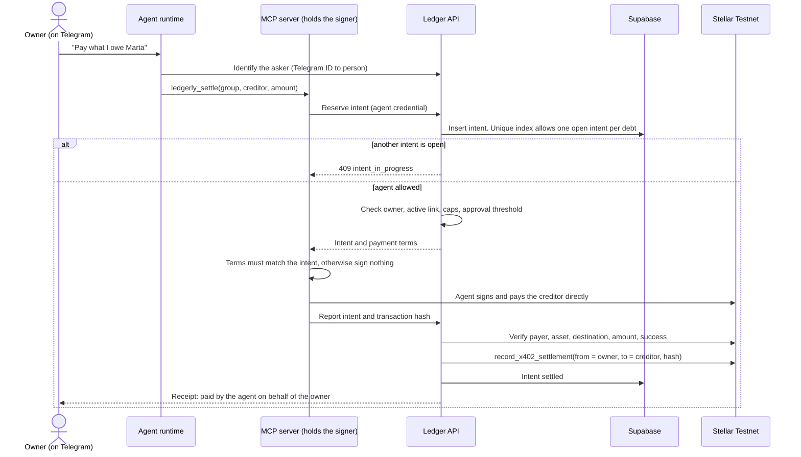
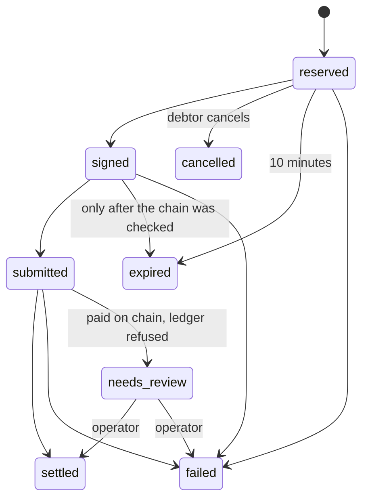

# Delegated payments: a person and their agent

Status: design, 2026-10-25. Nothing in this document is implemented. The SQL in `docs/schema/` is tested in a throwaway database but not applied. Network: Stellar Testnet only.

The decisions behind it are recorded as ADRs 0001 to 0006 in `docs/adr/`. This document explains how they fit together. It extends `docs/ARCHITECTURE.md` (settlement intent, rule 8) and `docs/AGENT-WALLETS.md` (signer and x402 flow).

## 1. What we want

A person (for example Victor) has an account. Their agent has its own account, related to the person's. When a debt has to be paid, **either of them can pay it**: the person signs with Freighter, or the agent pays from its own float within limits. The debt is always the person's debt, and it must never be paid twice.

## 2. Scope against the hackathon cut

| Piece | Where it sits |
|---|---|
| Human settlement with Freighter | Required demo (`docs/BUILD-FOCUS.md`) |
| Settlement intents with one open intent per debt (ADR 0003) | Belongs to the required demo too: the plain transfer is not atomic, so the lock protects the human flow |
| People, agents, signed link, agent pays on behalf (ADR 0001, 0004, 0005) | Stretch, together with the signer and `ledgerly_settle` |
| Allowance based on-chain limits (ADR 0006) | Roadmap, phase 2 |

## 3. Vocabulary

| Term | Meaning |
|---|---|
| Person | A human member. Controls a Stellar address through Freighter. |
| Agent identity | Software acting for one person: own Stellar address, spend policy, API credential. Always sponsored by a person (ADR 0001). |
| Link | The owner's signed statement that an address is their agent (ADR 0005). |
| Debt | What a debtor owes one creditor in one group, derived from expenses and verified settlements. |
| Settlement intent | A reservation to pay a debt. At most one is open per debt (ADR 0003). |
| Payer | The address that actually sends the USDC: the debtor, or the debtor's active agent. |
| Recorder | The contract role that records a verified settlement. Held by the API (ADR 0004). |
| Float | The small USDC balance of an agent account. It is the owner's money. |

## 4. How a payment works

### 4.1 Human payer

1. The web app asks the API to reserve an intent for the debt. If another intent is open, the API answers `409 intent_in_progress` and says who holds it.
2. The API returns the intent with an expiry. The Freighter adapter checks account, network, asset, amount and creditor (`apps/web/src/wallets/freighter/README.md`) and the person signs.
3. The signed transfer is submitted. The intent moves to `signed` and then `submitted` with the transaction hash.
4. The API verifies the transaction on Stellar Testnet and records the settlement. The intent becomes `settled`.

### 4.2 Agent payer (stretch)

The agent's own model never chooses the asset, the network or the destination. They come from the intent, and the signer refuses anything that differs (PRD FR-38).

### 4.3 Intent states

Open means `reserved`, `signed` or `submitted`. The database allows one open intent per debt. Terms never change after reservation, and intents are never deleted.

## 5. Preventing a double payment

| Risk | Control |
|---|---|
| Person and agent pay at the same time | One open intent per debt, enforced by a unique index. The second request gets `409` before anything is signed. Checked with 30 parallel connections: 1 won, 29 failed. |
| A retry after a timeout | Idempotency key unique per payer address. The same key returns the same intent. |
| The same transaction counted twice | `tx_hash` is unique across intents, and the contract rejects a repeated hash. |
| Agent signed, response lost | The intent stays `signed`. It is never auto-expired. A reconciliation job checks the chain before it can be closed. A new signature is only allowed after the previous one has expired and the chain shows no matching transfer. |
| Balance changed between reservation and record (a new expense) | The record is refused, the intent becomes `needs_review`, and an operator corrects it with an adjusting expense. The money is not lost. |
| Human `settle` through the contract | Atomic: a second `settle` fails with `Overpay` before any transfer. The lock still applies first. |
| The person wants to take over from the agent | Only a `reserved` intent can be cancelled. After the agent signs, the person waits for it to settle or expire. |

## 6. Security analysis

| Threat | Result |
|---|---|
| Prompt injection tells the agent to pay someone | Payments go only to the creditor of a real debt of the owner, through an intent. Caps and the approval threshold are enforced by the API. |
| A different team member asks the shared agent to pay | The agent applies the asker's rights. Only the owner's debts can be paid (ADR 0001, 0002). |
| Someone links their own address to another person's account | The link needs a signature from the person's wallet, and the database refuses an active agent without it (ADR 0005). |
| Agent key stolen | Loss is limited to the float (50 USDC at most). The owner revokes the agent, and the API stops recording its payments. |
| Recorder key stolen | The attacker can write false settlement records but cannot move funds. The contract can be paused, but today the recorder cannot be rotated (threat model T-21 and T-22), so the only recovery is a new deployment. This is the main secret to protect (ADR 0004). |
| Browser reads other people's intents | Row level security allows only a person's own rows. The browser cannot write intents or read credential hashes. |
| A secret key is typed into the chat | The MCP rejects anything shaped like a Stellar secret key in any field. |

Telegram allowlists decide who can reach the model. They do not authorise a payment (ARCHITECTURE section 11).

## 7. Data model

`docs/schema/delegated-payments.sql` defines `people`, `agents`, `agent_credentials` and `settlement_intents`, plus row level security. Credentials are stored as hashes. No key, signed payload or secret is stored.

`docs/schema/delegated-payments.test.sql` has 21 checks that a statement must be refused and 4 blocks that check a result, run in PostgreSQL 15 with a stub of Supabase's `auth` schema. They cover the unique guard, the state machine, who may pay, caps, testnet only, expiry rules, agent rules and row level security, and statements that must succeed run between them. The commands are in `docs/schema/README.md`.

## 8. Test plan

The database cases above already exist. The rest needs the API and the MCP server.

| ID | Case | Expected | Status |
|---|---|---|---|
| DP-01 to DP-09 | Open intent uniqueness, parallel creditors, state machine, unique hash, who may pay, caps, expiry, `needs_review` | As in `delegated-payments.test.sql` | Written and passing |
| RLS-01 to 03 | A person sees only their own rows and cannot write | Same file | Written and passing |
| DP-10 | Person and agent reserve the same debt together through the API | One 201, one 409 | Needs API |
| DP-11 | Retry with the same idempotency key | Same intent, no second payment | Needs API |
| DP-12 | Agent signed, the response is lost | Intent stays `signed`, no second signature before expiry | Needs MCP and API |
| DP-13 | Transfer confirmed, ledger refuses the record | `needs_review`, no silent loss | Needs API |
| DP-14 | Person cancels a `reserved` agent intent, then pays | Allowed. After `signed`, refused | Needs API |
| DP-15 | Another member asks the shared agent to pay their own debt | Refused or sent for approval | Needs agent and API |
| DP-16 | Amount above the agent's per transaction cap | Refused before signing | Needs API |
| LK-01 | Link signed by the wrong address, expired or reused nonce | Agent stays `pending_link` | Needs API and Freighter |
| LK-02 | Revoke while an intent is `reserved` | Intent cancelled, agent cannot sign | Needs API |
| RK-01 | Recorder key not present in the browser bundle, agent containers or logs | Not found | Needs deployment |

## 9. Roadmap

1. **Hackathon, required:** intents and the lock in the human flow, with the settlement route from ARCHITECTURE.
2. **Hackathon, stretch:** people, agents and signed link, agent pays on behalf with the caps of PRD 7.4, one demo owner for the shared agents.
3. **Phase 2:** token allowance for on-chain caps (ADR 0006), per-person agents, approvals and kill switch (story 19), reconciliation job.
4. **Later:** contract delegates (ADR 0004 alternative) if the allowance cannot carry x402.

## 10. Open points

| Point | Owner |
|---|---|
| Name the person who owns the shared demo agents (ADR 0002) | Team |
| Verify how Freighter signs the link: message or challenge transaction (ADR 0005) | Whoever builds the wallet adapter |
| Confirm that the verifier may accept an agent as payer (ADR 0004). The PRD text assumes payer and debtor are the same address | API owner |
| Recorder key: rotation function, separate admin and recorder keys, custody runbook, reconciler (threat model T-21, T-22) | Contract and API owners |
| Reconciliation job for `signed` intents | API owner |
| Where the SQL goes: `database/migrations/` is listed as scaffolding in ARCHITECTURE | Team |
| The deployed contract's group 1 uses native XLM. New groups need the Testnet USDC token | Contract owner |

## 11. Not verified

PostgreSQL behaviour was tested in a throwaway PostgreSQL 15, not in Supabase. Freighter signing, the x402 client with a spender-based transfer, the Stellar Asset Contract allowance behaviour, and the whole API flow have not been tried. Anything marked "Needs API" is unwritten.
