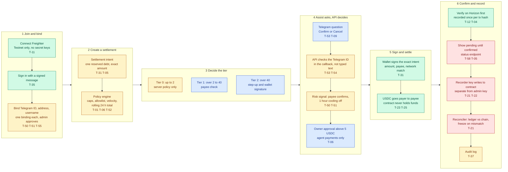
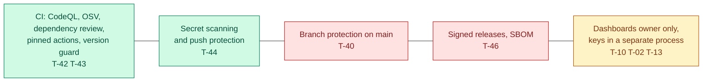

# Security and logic review: one-page map

Draft, 2026-10-25, status read from `main` at `f7fbdcc`. For the review with Sofiia and the team. Edit the text inside the `mermaid` block, paste it into [mermaid.live](https://mermaid.live) to preview, and change a colour when something changes status.

The map follows one payment from joining a group to a recorded settlement. Each box shows a **security control** and the threat IDs from [`../threat-model.md`](../threat-model.md) that it answers. The tier logic is in [`../verification-policy.md`](../verification-policy.md).

| Colour | Meaning |
|---|---|
| Green | Built: code or config on `main` does it |
| Blue | Simulated: shown in the web app, but nothing real behind it yet |
| Amber | Planned: designed, not built |
| Red | Gap: missing, or documented but not true today |

Tier 0 payments skip stage 4 and go straight to signing. Tier 1 and Tier 2 go through stage 4.

### Always-on controls

## What to align on with Sofiia

| # | Question | Why it matters |
|---|---|---|
| 1 | Is the order right: bind, intent, tier, Stellar Assist asks, sign, verify, record? | Everything else hangs on this sequence. |
| 2 | Do the colours match what the team thinks is built? Blue boxes are simulated in the app (PR #75), not real. | Judges will ask what is real. |
| 3 | Should Tier 2 be 40 or the equivalent of EUR 30? | The EU low-value exemption is EUR 30. See `verification-policy.md` section 7. |
| 4 | Where does the agent owner approval (above 5 USDC) sit relative to the tiers? | Drawn after the risk check here. Confirm with Victor. |
| 5 | Which red boxes must be fixed before the demo, and which are roadmap? | Branch protection and separate admin and recorder keys are the cheapest. |
| 6 | Do we pitch the tiers as built, simulated or roadmap? | The honest answer today is simulated. |

## Open red boxes, cheapest first

1. **Branch protection on `main`** (T-40). A setting, not code.
2. **Separate recorder and admin keys** (T-21, T-22). One deploy config change.
3. **Pending until confirmed and a status endpoint** (T-05, T-58). Small API change.
4. **Reconciler** (T-21). Larger. Call it roadmap unless time allows.
5. **Signed releases and SBOM** (T-46). Roadmap.
