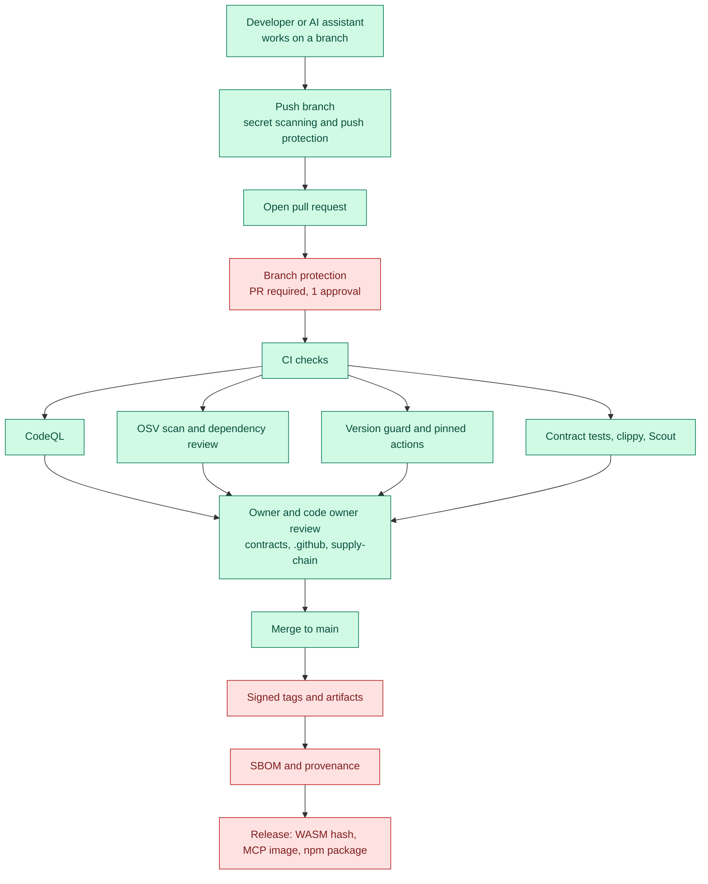
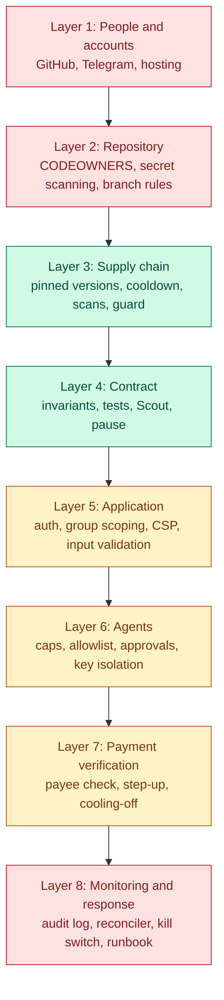

# Security workflow: Stellar-Split product suite

Draft, 2026-10-25, status as read from `main` at `4197089`. Edit with the team. See [`README.md`](README.md) for the colour key.

The suite: the Soroban group contract, the web app, the API, the MCP server, the agents (Hermes, OpenClaw) and the repository and CI that build them.

## Chart A. From code change to release

## Chart B. A payment at runtime

```mermaid
flowchart TB
  classDef built fill:#d1fae5,stroke:#047857,color:#064e3b
  classDef planned fill:#fef3c7,stroke:#b45309,color:#78350f
  classDef gap fill:#fee2e2,stroke:#b91c1c,color:#7f1d1d

  subgraph Humans
    H1["Member opens web app"]:::planned
    H2["Wallet signs the exact intent"]:::planned
  end

  subgraph Agents
    G1["Telegram message to Hermes or OpenClaw<br/>allowlisted team members"]:::built
    G2["MCP server<br/>validates input, rejects secret keys"]:::built
    G3["Signer in separate container"]:::planned
  end

  subgraph Backend
    P1["API: auth, group scoping"]:::planned
    P2["Policy engine<br/>caps, allowlist, velocity, tier check"]:::planned
    P3["Verification service<br/>Telegram ID, address, username"]:::planned
    P4["Approval to the owner, never in the agent chat"]:::planned
    P5["Chain verifier<br/>confirms on Soroban RPC"]:::planned
    P6["Reconciler<br/>ledger vs chain, freeze on mismatch"]:::gap
    P7["Audit log"]:::planned
  end

  subgraph Chain
    C1["Group contract<br/>non custodial, tests and Scout"]:::built
    C2["USDC transfer"]:::built
    C3["Recorder key<br/>shared with admin today"]:::gap
  end

  H1 --> P1
  H2 --> P5
  G1 --> G2 --> P1
  P1 --> P2
  P2 --> P3
  P2 --> P4
  P3 --> P2
  P2 -- allowed --> G3
  P2 -- allowed --> H2
  G3 --> C2
  H2 --> C2
  C2 --> P5 --> C3 --> C1
  C1 --> P6
  P2 --> P7
  P5 --> P7
```

## Chart C. Where the controls sit (layers)

## Triage notes (what Victor started, what is left)

| Layer | Started by the team | Still missing |
|---|---|---|
| People and accounts | Telegram allowlist, SSO on dashboards (docs) | Written recovery plan, 2FA on every GitHub account, bot token rotation |
| Repository | CODEOWNERS, secret scanning, push protection | Branch protection (a ruleset was prepared, not confirmed applied), signed commits |
| Supply chain | CI scans, pinned actions, version guard, approved list for the web app | MCP dependencies on the approved list, Dependabot for `/mcp` |
| Contract | Tests, Scout, pause, deployed on testnet | Separate admin and recorder keys, rotation, reconciler |
| Application | Web app scaffold | API, policy engine, auth, CSP |
| Agents | MCP read and propose tools, SOUL.md, key custody plan | `ledgerly_settle`, status endpoint, containers |
| Payment verification | This draft | Everything |
| Monitoring and response | Audit log in the PRD | Reconciler, incident runbook |
