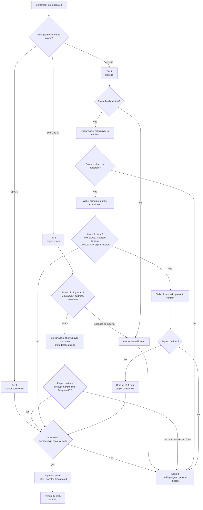

# Verification flow for one settlement

Draft, 2026-10-25, for Sofiia and the team. Numbers are parameters, see [`../verification-policy.md`](../verification-policy.md). Amounts are USD-equivalent and counted with the payer's other settlements to the same payee in the last 24 hours.

Notes for editing:

- Only the box "Policy ok?" and the diamonds are decisions. Stellar Assist boxes only carry a question and return what Telegram reports.
- A request that comes through an agent also needs the owner approval from PRD 7.4 above 5 USDC. That box is not drawn here to keep this chart readable. Add it as a second chart if the team wants it.
