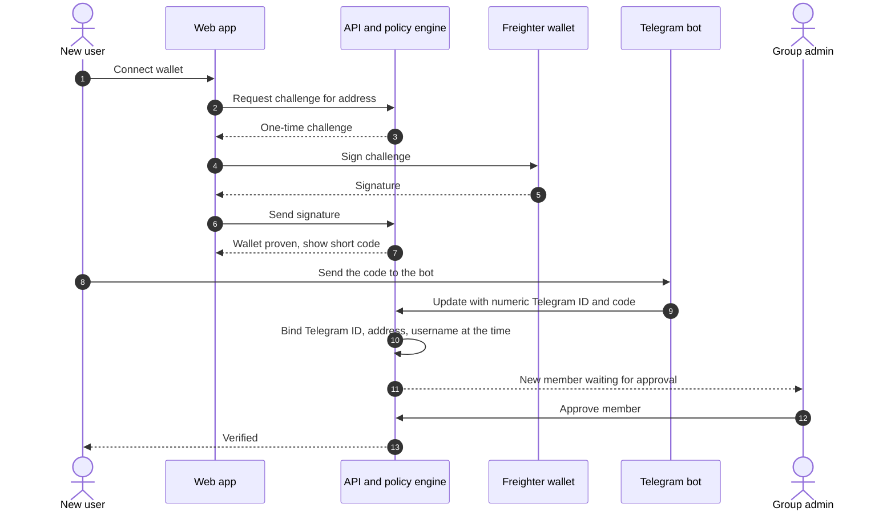
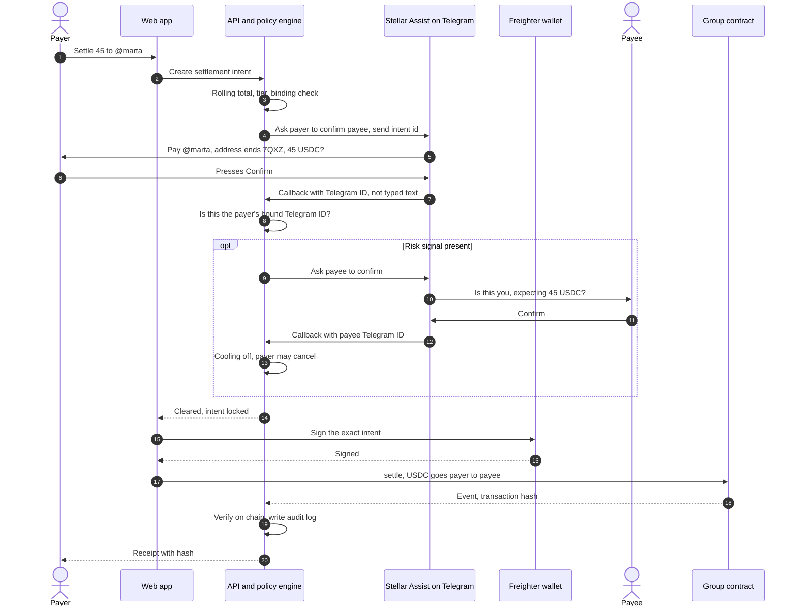

# Verification sequences

Draft, 2026-10-25, for Sofiia and the team. See [`../verification-policy.md`](../verification-policy.md).

## One-time binding of a new user

## Tier 1 and Tier 2 payment checks

