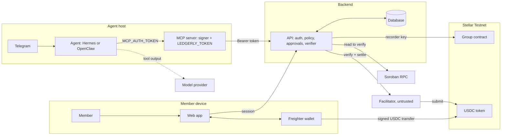

# Threat model

Status: draft for review by the security owner (@vestival). Date: 2026-10-25. Written against `main` at `4197089` (PRD v0.4).
Extends PRD section 9.1. The PRD table stays the summary; this file is the working register.

Stellar-Split (working name Ledgerly) keeps a shared-expense ledger on a Soroban contract and settles in USDC. Humans use a web app with Freighter. Agents (Hermes, OpenClaw) use an MCP server and pay over x402. Everything runs on **Stellar Testnet**. The model below is written for mainnet, so the ratings assume real money.

How to read the **Status** column: **Built** means code or config on `main` does it and the evidence column points at it. **Planned** means a design exists and nothing is built. **Gap** means neither exists, or the PRD claims more than the repo shows.

## 1. Assets

| ID | Asset | Why it matters |
|---|---|---|
| A1 | Members' USDC | Direct loss if moved wrongly. The contract never holds it. |
| A2 | Agent signing keys and float | Each agent has its own funded account. A leak loses the float. |
| A3 | Group ledger integrity (balances, expenses, settlements) | The product's promise is that "who owes whom" is correct. |
| A4 | API credentials (`LEDGERLY_TOKEN`, `MCP_AUTH_TOKEN`, API keys, sessions) | Act as an agent or member. |
| A5 | Admin and recorder keys | Pause the contract, or record settlements. |
| A6 | Group and personal data (names, amounts, descriptions, receipts) | Privacy. Kept off-chain, only hashes on-chain. |
| A7 | Release integrity (source, WASM, MCP image, npm package) | A bad release reaches every user. |
| A8 | Team accounts and CI (GitHub, Telegram bot, hosting) | Path to every other asset. |

## 2. Actors

| Actor | Trust |
|---|---|
| Group member (human) | Authenticated by wallet. May be malicious toward other members. |
| Group admin | Adds members. One per group, set at creation. |
| Agent (Hermes, OpenClaw) | **Assumed manipulable.** No guardrail may depend on it behaving (PRD 7.4). |
| Agent owner | Sets caps, approves above threshold. |
| Recorder (API key) | May write `record_x402_settlement`. Cannot move tokens. |
| Contract admin | May pause. No upgrade function exists today. |
| x402 facilitator (hosted) | **Untrusted for integrity.** Can censor, cannot steal. |
| Model provider | Sees what tool output the agent forwards. Untrusted for privacy. |
| Third-party skills and plugins | Untrusted by default. |
| Outsider | Internet, Telegram, fork PRs, package registries. |

## 3. Trust boundaries and data flow

Boundaries that matter most: **agent runtime to MCP server** (the model must never see the key), **API to facilitator** (verify the chain, not the facilitator's word), **API to contract** (the recorder key), and **repo to release** (CI).

## 4. Threat register

Likelihood and impact are Low, Medium or High, for a mainnet deployment. Risk is the higher of the two unless noted.

### 4.1 Agents and x402

| ID | Threat | L | I | Mitigation | Status | Evidence or gap |
|---|---|---|---|---|---|---|
| T-01 | Prompt injection makes an agent pay an attacker (chat message, document, receipt). | H | H | Counterparty allowlist, spend caps, approval threshold, all server-side. | Planned | PRD 7.4, tests OC-6, HA-6, INJ-01. The API does not exist yet (issues #10 to #13). |
| T-02 | Malicious skill or plugin on the agent host reads the key or calls settle. ClawHavoc-style skills. | M | H | Key lives in a separate MCP container, no key mount in the agent container, no third-party skills on paying agents, small float. | Planned | `docs/AGENT-WALLETS.md`. Tests KEY-01 to KEY-03. Nothing signs yet. |
| T-03 | Tampered 402 response changes `payTo`, amount, asset or network. | M | H | MCP compares the 402 to the intent it requested and signs nothing on mismatch. | Planned | PRD 7.1 step 4 (FR-38), tests SET-02 to SET-08. No signing code. |
| T-04 | Replay of a captured `PAYMENT-SIGNATURE`. | L | H | Nonce and ledger expiry in the auth entry, idempotency per intent, contract rejects a recorded tx hash. | Built (contract) | `DuplicateTx` in `contracts/group/src/lib.rs`, global per tx hash. API side planned. |
| T-05 | Double payment after a timeout: the agent re-signs while the first payment is in flight. | M | H | Query status by intent id before any re-sign. | Gap | No status endpoint. `docs/INCONSISTENCIES.md` item 8. Test SET-14. |
| T-06 | Agent raises its own caps or approves its own request. | M | H | Policy and approval endpoints need the owner's human session, never an agent credential. | Planned | PRD 7.4. API not built. |
| T-07 | Agent key leaked. Contract cannot rotate a member address. | M | M | Float no larger than the daily cap, revoke, sweep. Old member reaches net zero, new address joins as a new member. | Planned | `docs/AGENT-WALLETS.md` incident steps. No `update`/`remove member` in the contract. |
| T-08 | Tool output carries other members' data to an untrusted model provider. | M | M | Minimise tool responses. Docs tell owners to prefer a local or trusted model. | Planned | PRD 9.1. MCP tools return full API JSON today (`mcp/src/tools.js`, `reply()`). |
| T-09 | Telegram bot token stolen, or the chat spoofed, so an attacker drives an agent. | M | H | Per-user allowlist on numeric Telegram IDs, approvals delivered to the owner and never into the agent's own chat, no paying tool enabled without approval mode, bot tokens kept out of the repo. | Built (documented, server-side) | `docs/AGENTS.md`: allowlist checked before the model sees a message, five team members, both bots are admins of the group. The allowlist and tokens live on the server, so the repo cannot prove them. Still missing from PRD 9: the threat itself, bot token rotation, and a rule that approvals never arrive in the agent's chat. |
| T-10 | Agent dashboards or MCP port exposed to the internet. | M | H | Loopback or private network for the MCP port, `MCP_AUTH_TOKEN` required off loopback, SSO in front of any dashboard. | Built (MCP), documented (dashboards) | `mcp/src/http.js` refuses a non-loopback host without a token. `docs/AGENTS.md` says SSH is private over Tailscale, but the two agent dashboards are published through a Cloudflare tunnel behind Authentik SSO. That is an internet-facing login page, and PRD 9.3 says Tailscale. Align the PRD, keep the dashboards owner-only, and keep them off any host that holds a signing key. |
| T-11 | Secret keys pasted into prompts, tool arguments or logs. | M | H | Reject `S[A-Z2-7]{55}` in every field, never log tokens. | Built (partly) | `mcp/src/tools.js`. Covers the `S…` format only, not mnemonics or hex seeds. |
| T-12 | Facilitator lies or is compromised: reports success without a transfer. | M | H | API confirms asset, amount, payer, payee and network on Soroban RPC before recording. | Planned | PRD 7.1 step 9, 9.3. Verifier not built (issue #12). |
| T-13 | MCP server compromise. | L | H | Separate process and credential, non-root, read-only filesystem, `cap_drop ALL`, egress to the API only, tools never accept payment terms from the model. | Planned | `docs/AGENT-WALLETS.md`. No container config in the repo yet. |

### 4.2 Contract and ledger

| ID | Threat | L | I | Mitigation | Status | Evidence or gap |
|---|---|---|---|---|---|---|
| T-20 | **Unilateral expense:** any member can post an expense that charges any other members, because only the payer authorises `add_expense`. | H | M | Debited members confirm or can dispute. Cap on size or visibility until confirmed. Settlement still needs the debtor's own signature, so no funds move. | Gap | `add_expense` calls `payer.require_auth()` only. New finding. |
| T-21 | **Recorder key compromise:** a forged `record_x402_settlement` zeroes real debts without any payment. | M | H | Reconciliation job re-checks every recorded hash against the chain and freezes the group on mismatch. Recorder key never on a public-facing host. Separate recorder and admin keys. | Gap | Contract trusts the recorder fully and does not check the chain. Reconciler is issue #21, not built. `README.md` lists **one address as both admin and recorder** on the deployed contract, so one stolen key can pause the contract and forge records. |
| T-22 | Admin key lost or stolen. Admin and recorder cannot be rotated. | L | M | Constructor sets both once. Add rotation, multisig on mainnet. | Gap | No rotation function in `lib.rs`. The deployed contract's admin and recorder are the same account (`README.md`), so losing it loses both roles for good. |
| T-23 | Pause abused, or pause needed and the admin unavailable. | L | M | Pause stops new expenses and records. It never locks funds because the contract holds none. | Built | `set_paused`, `require_not_paused`. |
| T-24 | Upgrade path abused. | L | H | Timelock, multisig, WASM hash in signed release. | Gap | PRD 9.2 describes it. **No upgrade function exists**, so today the contract is immutable. Pick one on purpose. |
| T-25 | Rounding or overflow changes balances. | L | H | Checked arithmetic, `i128`, deltas must sum to zero. | Built | `add()` uses `checked_add`. 15 of 15 contract tests pass. Gaps listed in `docs/TESTING.md` (creditor-side `Overpay`, overflow paths, event checks). |
| T-26 | Unbounded storage makes group reads expensive. | L | M | `MAX_MEMBERS = 50`, per-member persistent keys. | Built | `lib.rs`. TTL extension untested (`docs/TESTING.md`). |
| T-27 | Off-chain expense altered after creation. | M | M | Append-only expenses, hash on-chain, reconcile database against contract. | Planned | `expense_hash` stored on-chain, database not built. |

### 4.3 Web app and API

| ID | Threat | L | I | Mitigation | Status | Evidence or gap |
|---|---|---|---|---|---|---|
| T-30 | Member A reads or edits group B's data. | M | H | Group-scoped authorisation at the query layer, a negative test per endpoint. | Planned | PRD 9.3. PRD v0.4 puts the off-chain ledger on Supabase (PostgreSQL) behind a repository layer. That needs a row-level security model, a rule that the service key never reaches the browser, and a negative test per table. |
| T-31 | Freighter prompt does not match what the UI shows, so the user signs the wrong transfer. | M | H | Build the transaction from the verified settlement intent, show amount, payee and network from the same object, refuse a non-testnet wallet. | Planned | Issue #16 acceptance criteria. Screens are placeholders. |
| T-32 | XSS in the web app steals sessions or drives the wallet. | M | H | CSP without `unsafe-inline`, no HTML injection of member text, `frame-ancestors 'none'`. | Planned | Issue #16, PRD 9.3. |
| T-33 | Invite link guessed or leaked, so a stranger joins a group. | M | M | Single-use, expiring, high-entropy links, admin confirms the new member. | Gap | `Join` and `GroupInvite` routes exist as placeholders. Not in PRD 9. |
| T-34 | Receipt scanning carries prompt injection or malicious files. | M | M | Treat OCR text as data, size and type limits, no tool access from the scan step. | Gap | `ExpenseScan` route is a placeholder. Not in PRD 9. |
| T-35 | Forged agent or API credential, or a stolen key. | M | H | Hashed keys, short-lived tokens, instant revocation. | Planned | PRD 9.3. |
| T-36 | Flood of 402 challenges or settlements drains facilitator quota. | M | M | Rate limits, velocity check, per-key quotas. | Planned | PRD 7.4. |
| T-37 | Member denies authorising an action. | M | M | Audit log with tool call, policy decision, approval and tx hash. | Planned | PRD 7.4. |
| T-38 | Logs leak amounts, tokens or payloads. | M | M | Structured logs, ids only. | Planned | PRD 9.3. |

### 4.4 Repository, CI and supply chain

| ID | Threat | L | I | Mitigation | Status | Evidence or gap |
|---|---|---|---|---|---|---|
| T-40 | Direct push or force-push to `main`, or an unreviewed merge. | M | H | Branch protection or ruleset, required checks, required review. | **Gap** | `gh api .../branches/main/protection` returns 404 "Branch not protected" on 2026-10-25. PRD 9.4 says it is on. |
| T-41 | Unsigned or impersonated commits. | M | M | Signed commits, vigilant mode. | Gap | The local `git log` shows no signature on recent `main` commits. Not yet checked as GitHub reports it. |
| T-42 | Malicious or vulnerable dependency. | M | H | Lockfiles, exact versions, 7/14/30 day cooldown, OSV scan, dependency review, version guard. | Built (partly) | Workflows `osv-scanner`, `dependency-review`, `version-guard` exist. `approved-versions.json` now lists 13 web-app packages, but not the MCP server's two dependencies (`@modelcontextprotocol/sdk`, `zod`), which sit in the agent path. Dependabot has no `/mcp` entry. Dependency review fails on every PR until the repository's Dependency graph is on (`docs/TESTING.md`). |
| T-43 | Compromised GitHub Action. | L | H | Every `uses:` pinned by SHA. | Built | `pinned-actions.yml`, `check-actions-pinned.sh`. |
| T-44 | Secret committed. | M | H | Secret scanning and push protection. | Built | `gh api` shows both enabled. |
| T-45 | Malicious fork PR runs with secrets. | L | H | No `pull_request_target`, no secrets on fork PRs. | Built (by absence) | None of the six workflows uses `pull_request_target`. |
| T-46 | Release tampered. | L | H | Signed tags and artifacts, provenance, SBOM, protected `release` environment. | Gap | No release workflow, no SBOM, no signing key published in `SECURITY.md` yet. |
| T-47 | Vulnerability found and reported in public. | L | M | `SECURITY.md`, private reporting. | Built | `SECURITY.md` on `main`. Whether private reporting is switched on in settings is not checked. |

### 4.5 Payment identity and verification

New rows from [`verification-policy.md`](verification-policy.md). Evidence for each is in [`references/incidents.md`](references/incidents.md).

| ID | Threat | L | I | Mitigation | Status | Evidence or gap |
|---|---|---|---|---|---|---|
| T-50 | **Wrong payee:** the payer pays an address that is not the person they think it is (look-alike address, swapped invite, impersonation). | H | H | Payee check above 2 USD-equivalent: name, bound Telegram ID and full address compared on the server. | Planned | Draft policy. Address poisoning study (Tsuchiya and Christin, 2025). Nothing built. |
| T-51 | Telegram username changed or taken over after binding, so the name no longer means the same person. | M | H | Bind to the numeric Telegram ID, treat the username as a label, flag any change and re-verify. | Planned | Draft policy. Telegram Bot API: `username` is optional. |
| T-52 | Structuring: a large payment is split into small ones to stay under a tier. | M | M | Rolling 24 hour total per payer and payee counts toward the tier. Velocity limit already in PRD 7.4. | Planned | Draft policy. Precedent: EU low-value exemption counts cumulative amounts. |
| T-53 | Verification agent talked into approving (prompt injection, forged chat text, fake memory). | M | H | Hermes only carries questions. The API decides from Telegram-authenticated callbacks and wallet signatures. No approval inside the agent's own chat. | Planned | Draft policy. Greshake et al. 2023, Patlan et al. 2025. |
| T-54 | Telegram account takeover (SIM swap, stolen session) used to confirm a payment. | M | H | Tier 2 also needs a wallet signature on the exact intent. Telegram alone never moves money. | Planned | Draft policy. Banana Gun 2024 fixed with a delay and a second factor. |
| T-55 | One person creates many wallets and Telegram accounts to look like many members (Sybil), or two accounts claim one address. | M | M | One binding per address and per Telegram ID, admin approval of new members. | Planned | Draft policy. Douceur 2002. |
| T-56 | A public verification bot is abused (spam, injection from strangers, token theft). | M | H | Keep the team bot allowlisted. Build any public bot as a separate minimal service after its own threat review. | Gap | `docs/AGENTS.md` allows five named team members only. |
| T-57 | Telegram ID and wallet pairs are leaked or over-kept, enabling targeted scams. | M | M | Keep only the binding triple, retention period, delete on request, no message text in logs. Data-protection check before launch. | Gap | Coinbase 2025 shows leaked customer data feeds impersonation. No privacy notice or retention rule yet. |
| T-58 | Stellar network stalls or confirms slowly, so a payment is neither failed nor final. A 2019 study found the validator structure concentrated and a two-node loss able to halt the network. Today's network may differ. | L | M | Show "pending" until the chain confirms, verify on Soroban RPC before recording, status endpoint, no re-sign until the first authorisation has expired. | Planned | Kim, Kwon and Kim 2019 (`references/README.md`, A7). Verifier is issue #12, status endpoint is a gap (T-05). |

## 5. Contract and agent findings to act on first

Ranked by value for the demo and for credibility.

1. **T-40 Protect `main`.** Cheapest high-value fix. It is a setting, and the PRD already claims it.
2. **T-21 Recorder trust.** Document it plainly as a trust assumption in `SECURITY.md`. Build the reconciler before any mainnet claim.
3. **T-20 Unilateral expense.** Decide the rule (confirmation by debited members, or accept it and say so) before the demo shows a split.
4. **T-05 Status endpoint** and the signing flow in `ledgerly_settle`. No payment tool should ship without it.
5. **T-10 and T-09.** Add the Telegram and dashboard threats to PRD 9.1, and align 9.3 (Tailscale) with the Cloudflare tunnel and Authentik setup in `docs/AGENTS.md`.
6. **T-24 Upgrade policy.** Decide: immutable contract for the hackathon (simplest, strongest claim), or add the timelocked upgrade the PRD describes.
7. **T-21 and T-22 key separation.** Use a different recorder key from the admin key before any demo of x402 recording.
8. **T-42 Dependabot `/mcp`**, add the MCP dependencies to `approved-versions.json`, turn on the Dependency graph.

## 6. Decisions needed

| Decision | Options | Owner |
|---|---|---|
| Upgradeable or immutable contract for the event | Immutable now, add upgrade later in a new contract / build timelock now | @vestival |
| Unilateral expenses | Require debited-member confirmation / document as accepted | @vestival, product |
| MCP ceiling of 25 USDC | Keep a second cap in the MCP / API only (`docs/AGENT-WALLETS.md`) | @vestival |
| Recorder and admin rotation | Add to contract / accept for testnet | @vestival |
| Database | Supabase (PRD v0.4) needs a row-level security model before any data goes in | @damcb1 |
| Recorder and admin keys | Use two separate accounts on the next deploy / keep one for testnet | @vestival |

## 7. What we can claim publicly

Marketing must match the repository. Use the right-hand column as the wording. Do not use a claim that is marked Planned or Gap in the present tense.

| Claim | Evidence today | Safe wording |
|---|---|---|
| Non-custodial | The contract has no function that holds tokens. `settle` calls `token.transfer(from, to)`. | "The contract never holds your funds." |
| Testnet only | `.env.example` is not yet in the repo. Network check in the app is planned. | "Runs on Stellar Testnet." |
| Agents cannot be talked into overspending | Caps, allowlist and approvals are designed, not built. | "Designed so limits are enforced on the server, not by the agent." |
| Agent keys are isolated | Design only. | "Agent keys are planned to live in a separate process." |
| Secret keys rejected | Built in the MCP input schemas, with tests. | "The agent interface rejects Stellar secret keys." |
| Dependencies pinned and checked | Pinned actions, OSV, dependency review, version guard in CI. | "Dependencies are pinned and scanned in CI." Do not say "every dependency is approved" until the MCP and API packages are on the list. |
| Contract audited | 15 contract tests and `cargo scout-audit` in CI. No external audit. | "Unit tested and statically analysed. Not externally audited." |
| Signed releases, SLSA, SBOM | None built. | Do not claim. |
| Branch protection and signed commits | Not enabled today. | Do not claim until T-40 and T-41 are fixed. |

## 8. Review

This register should be reviewed when the API, the signing flow or the database lands, and again before any mainnet step. Each row's status moves to **Built** only with a link to code, config or a passing test.
